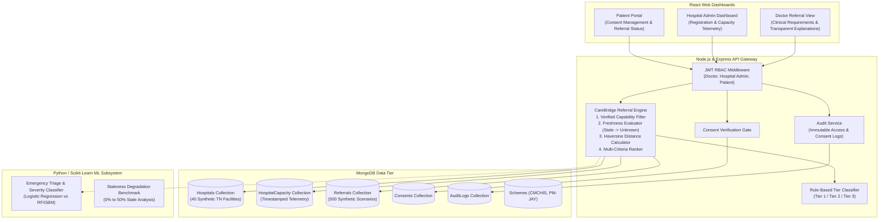
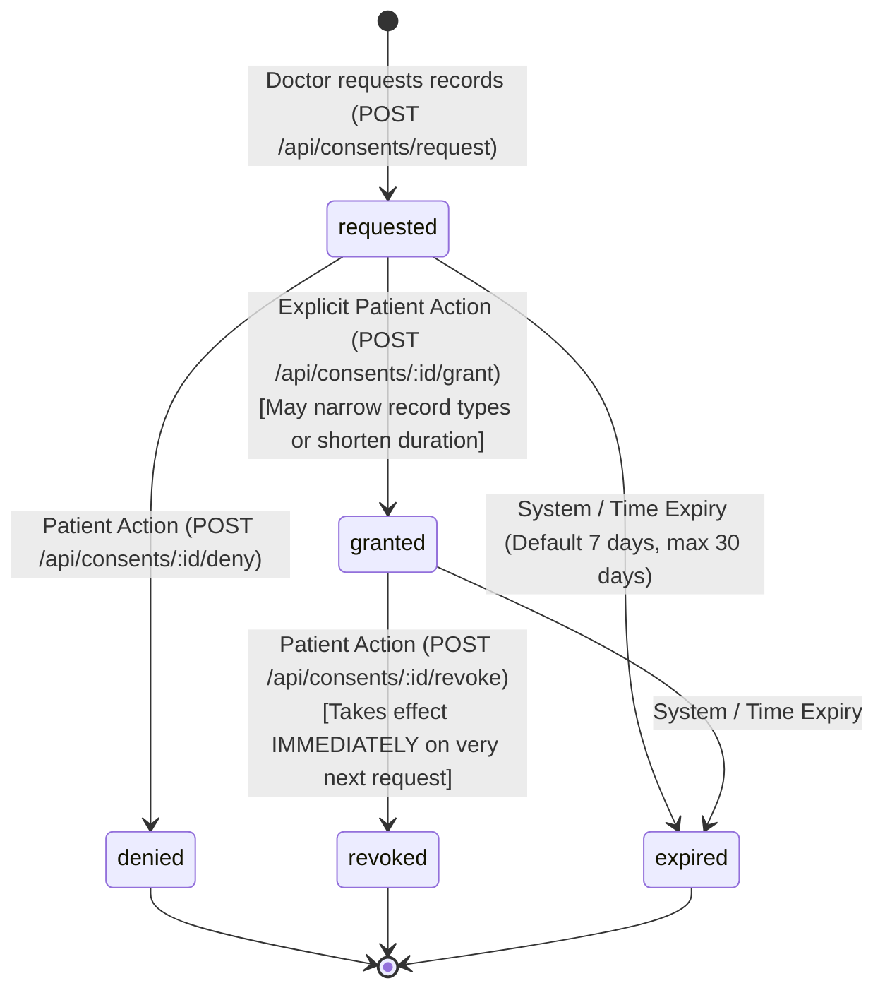

# CareBridge: Capability-Verified, Freshness-Aware Hospital Referral Platform

> **RESEARCH PROTOTYPE NOTICE & CLINICAL DISCLAIMER:**  
> **Decision support only. A clinician must review.**  
> CareBridge is a health-informatics research prototype designed for evaluating capability-verified, freshness-aware referral engines in Tamil Nadu, India. All clinical and hospital records are synthetic. CareBridge does NOT make clinical diagnoses or replace clinical judgement, and makes no unsubstantiated claims of improved medical outcomes, reduced delays, or cost reduction.

---

## 1. Project Overview & One-Sentence Research Contribution

> **Core Research Contribution:**  
> A referral engine that ranks hospitals by **verified clinical capability first**, then capacity and distance, and treats **stale or missing capacity data as "unknown"** rather than "available".

Conventional referral systems frequently succumb to two fundamental pitfalls:
1. **The Proximity Fallback Fallacy**: Defaulting to the nearest hospital regardless of whether it actually possesses the required specialist, ventilator, or catheterization lab.
2. **The Staleness Assumption Fallacy**: Treating out-of-date bed numbers as currently "available", resulting in futile emergency transfers and patient diversions.

CareBridge addresses these challenges through transparent rule-based capability verification, dynamic telemetry staleness thresholds, and freshness-aware rank scoring.

---

## 2. System Architecture



---

## 3. Architecture Decision Records (ADRs)

### ADR-001: Rule-Based Matching for Referral Ranking
- **Context**: Selecting recipient hospitals for high-acuity patients requires strict adherence to clinical standards (e.g., patient requiring invasive ventilation cannot be sent to a hospital with 0 ventilators).
- **Decision**: Implement a **deterministic, rule-based capability filter** followed by transparent multi-criteria ranking rather than a black-box machine learning recommender.
- **Rationale**: 
  - Clinical explainability is paramount: Clinicians need explicit reasons ("Has Pulmonologist on-call 24x7, 4 ICU beds verified 35m ago, 18.2 km via Haversine").
  - Zero tolerance for hallucinated capabilities: Machine learning models can recommend non-equipped facilities based on spurious correlations.
  - Transparent policy weights enable rigorous sensitivity and staleness analysis.

### ADR-002: Document Database with MongoDB & Mongoose
- **Context**: Hospital clinical capacities, equipment inventories, and telemetry snapshots feature nested structures and frequent updates.
- **Decision**: Use MongoDB with structured Mongoose schemas and strict schema-level validation.
- **Rationale**:
  - Flexible subdocuments for complex equipment matrices (`ventilators`, `cardiacCathLab`, `bloodBank`) and timestamped capacity snapshots.
  - Geospatial indexing support for coordinates in Tamil Nadu.
  - In-memory embedded fallback (`mongodb-memory-server`) ensures the prototype runs seamlessly without mandatory external daemon setup.

### ADR-003: Stateless JWT with Role-Based Access Control (RBAC)
- **Context**: CareBridge handles simulated patient records and sensitive referral actions across three distinct stakeholder personas: `patient`, `doctor`, and `hospital_admin`.
- **Decision**: Use signed JSON Web Tokens (JWT) containing actor role and hospital affiliation, verified server-side on every protected endpoint.
- **Rationale**:
  - Secure, tamper-proof role assertion.
  - Server-side consent checks verify resource authorization independent of client-provided IDs.

### ADR-004: Freshness-Aware Semantics (Stale = "Unknown")
- **Context**: Telemetry from hospitals often goes stale due to network interruptions or administrative delays. Naive systems treat stale data as currently available.
- **Decision**: Enforce a configurable `stalenessThresholdMinutes` (default 120 minutes). If telemetry timestamp exceeds this threshold, effective capacity is evaluated as `'unknown'`.
- **Rationale**:
  - Treating stale capacity as "available" causes futile emergency transfers.
  - Treating stale data as "unknown" penalizes stale hospitals in ranking, incentivizing timely telemetry reporting.

---

## 4. Repository Structure

```
carebridge/
├── backend/
│   ├── data/                                 # Exported synthetic benchmark datasets
│   │   ├── synthetic_hospitals.json          # 40 Tamil Nadu synthetic hospitals
│   │   ├── synthetic_referral_scenarios.json # 500 scenarios with ground-truth
│   │   └── synthetic_schemes.json            # CMCHIS and PM-JAY catalogue
│   ├── src/
│   │   ├── config/
│   │   │   └── db.js                         # DB connector (MongoDB / MongoMemoryServer)
│   │   ├── models/
│   │   │   ├── Hospital.js                   # Capabilities, equipment, beds, status, tier
│   │   │   ├── HospitalCapacity.js           # Timestamped beds & freshness evaluation
│   │   │   ├── Referral.js                   # Clinical requirements & recommendation items
│   │   │   ├── Consent.js                    # Patient record sharing authorizations
│   │   │   ├── AuditLog.js                   # Immutable access & action logs
│   │   │   ├── User.js                       # JWT auth & role definitions
│   │   │   └── Scheme.js                     # Health assurance scheme metadata
│   │   ├── scripts/
│   │   │   ├── syntheticDataGenerator.js     # Deterministic TN synthetic generator
│   │   │   └── seed.js                       # Seeding and benchmark export script
│   │   └── tests/
│   │       └── phase1.test.js                # Schema, staleness & seed unit tests
│   └── package.json
├── ml/                                       # ML severity model & staleness experiments
├── frontend/                                 # React dashboards
├── docs/                                     # Research notes and evaluation charts
└── README.md
```

---

## 5. Phase 1 Verification & How to Run

### Run Unit Tests
```bash
cd backend
npm test
```
All 11 Phase 1 unit tests validate:
- Hospital schema validation and Tamil Nadu coordinate boundary checks.
- HospitalCapacity staleness detection and evaluation (`stale -> unknown`).
- Baseline comparison mode (`assumeAvailableIfStale`).
- Consent expiration logic and AuditLog immutability.
- Synthetic generation of 40 Tamil Nadu hospitals and 500 ground-truth scenarios.

### Run Seed Script
```bash
cd backend
npm run seed
```
This populates the database and exports `synthetic_hospitals.json`, `synthetic_referral_scenarios.json`, and `synthetic_schemes.json` into `backend/data/`.

---

## 6. Phase 2: Hospital Registration, Verification Workflow & Rule-Based Tiering

### 6.1 Proposed Capability Tier Rules (`config/tierRules.json`)
> **Important Research Note**: These tiers are **proposed research categories** for clinical decision support, **NOT** official statutory or government classifications. Tier indicates institutional infrastructure and does **NOT** equal patient suitability (patient referral matching is evaluated separately in Phase 3).

| Capability Tier | Category Label | Minimum Clinical Criteria |
| :--- | :--- | :--- |
| **Tier 1** | Advanced Tertiary / Quaternary | 24x7 Emergency Service, ICU Beds $\ge 20$, Ventilators $\ge 10$, CT Scanner, MRI Scanner, Clinical Laboratory, Operation Theatres $\ge 3$, Specialties $\ge 8$. |
| **Tier 2** | Secondary Referral / District Center | Inpatient Beds (General + Emergency + ICU) $\ge 30$, Clinical Laboratory, Diagnostic X-ray, Ultrasound Imaging, Operation Theatres $\ge 1$, Specialties $\ge 3$. |
| **Tier 3** | Basic Community Stabilization | Registered healthcare facility with basic stabilization and primary outpatient services. |

- **Effective vs. Unconfirmed Tiers**: Only a `verified` hospital receives an effective `confirmed` tier. Hospitals with `unverified` or `pending` status display their proposed tier clearly labeled `unconfirmed`.
- **Automatic Re-Classification**: Any edit to capability-defining fields (`specialties`, `equipment`, `bedCounts`, `has24x7Emergency`, `departments`) automatically re-runs tier evaluation and resets `verificationStatus` to `pending`.

### 6.2 Simulated Verification Workflow & States
```
[unverified] ──(submit-for-verification)──> [pending] ──(verify: reviewer)──> [verified]
                                               │
                                               └──(reject: reviewer)──> [rejected]
```
- **Simulated Consistency Checks**:
  Upon submission, the verification engine checks:
  1. Registration and license number formatting.
  2. Presence of mandatory compliance document metadata (`hospital_license` or `clinical_establishment_reg`).
  3. Internal clinical capability consistency (e.g., claiming CT/MRI without Radiology department or specialist; claiming ICU beds with zero mechanical ventilators; claiming 24x7 Emergency with zero emergency beds).
- **Protected Evidence Storage**: Evidence document metadata is maintained in MongoDB while simulated binary files are isolated in `storage/evidence/` with server-side authorization gates.
- **Authenticity Disclaimer**: Automated verification checks format and internal data consistency. It does **NOT** certify legal authenticity or physical presence, which in production requires cryptographic integration with the Tamil Nadu Clinical Establishments Act registry.

### 6.3 ADR-005: Rule-Based Tier Classification via External Configuration
- **Context**: Institutional capability criteria evolve as clinical guidelines, equipment mandates, and health policies shift across districts. Hardcoding thresholds in application code causes brittle deployments and opaque evaluations.
- **Decision**: Define institutional capability thresholds in an external configuration schema (`config/tierRules.json`) and evaluate them using a pure, deterministic function (`tierClassificationService.js`) returning `rulesMet`, `rulesMissed`, and `gapToNextTier`.
- **Rationale**:
  - Fully transparent and auditable: Clinicians, hospital administrators, and reviewers can view exact requirements and deficits.
  - Policy flexibility: Thresholds can be tuned or versioned without modifying core referral engine logic.
  - Deterministic evaluation: Guarantees repeatable classification without heuristic drift or ML hallucinations.

---

## 7. How to Run & Test Phase 2

### Run Full Test Suite
```bash
cd backend
npm test
```
All 27 unit and integration tests validate:
- Pure deterministic tier classification, boundary conditions (ICU beds 19 vs 20), and equipment deficit fallbacks.
- Input validation: negative bed rejection, ICU bed limits, Tamil Nadu bounding box compliance, unique registration numbers.
- Strict server-side ownership: `hospital_admin` cannot read or edit other hospitals; only `platform_reviewer` can verify or reject.
- Workflow transitions: capability edits reset verification status to `pending`; rejection requires an explicit reason.
- Consistency checks: cross-sectional imaging without radiology and ventilator-free ICUs generate automated warnings.

### Run Seed Script
```bash
cd backend
npm run seed
```
Creates 40 synthetic hospitals, per-hospital administrator accounts, and at least two
practitioner-linked doctor accounts per hospital. Each account receives a unique random
password saved locally in the git-ignored `backend/seed-credentials.json` file. The seed
command refuses to run when `NODE_ENV=production`; seeded synthetic accounts are also
refused by production login.

### Start the Backend Server
```bash
cd backend
npm start
# Server listens on http://localhost:5000
```

### Example API Requests (curl)

#### 1. Find local seeded login credentials
After seeding, open `backend/seed-credentials.json` locally and select the account
matching the desired role and hospital. Do not commit or share this file.

#### 2. Register a Hospital (`hospital_admin`)
```bash
curl -X POST http://localhost:5000/api/hospitals \
  -H "Content-Type: application/json" \
  -H "Authorization: Bearer <ADMIN_JWT_TOKEN>" \
  -d '{
    "name": "Synthetic Erode Heart & Lung Centre",
    "registrationNumber": "CEA-TN-2026-999",
    "district": "Erode",
    "location": {"latitude": 11.3410, "longitude": 77.7172},
    "ownership": "private_trust",
    "has24x7Emergency": true,
    "specialties": ["Cardiology", "Pulmonology", "Emergency Medicine"],
    "bedCounts": {"general": 50, "emergency": 10, "icu": 8},
    "equipment": {
      "ventilators": {"available": true, "count": 6},
      "xray": {"available": true, "count": 1},
      "ultrasound": {"available": true, "count": 1},
      "operationTheatres": {"available": true, "count": 2},
      "lab": {"available": true, "level": "advanced"}
    }
  }'
```

#### 3. Submit Hospital for Verification (`hospital_admin`)
```bash
curl -X POST http://localhost:5000/api/hospitals/<HOSPITAL_ID>/submit-for-verification \
  -H "Authorization: Bearer <ADMIN_JWT_TOKEN>" \
  -H "Content-Type: application/json" \
  -d '{"notes":"Annual compliance renewal submission"}'
```

#### 4. Approve and Verify Hospital (`platform_reviewer`)
```bash
curl -X POST http://localhost:5000/api/hospitals/<HOSPITAL_ID>/verify \
  -H "Authorization: Bearer <REVIEWER_JWT_TOKEN>" \
  -H "Content-Type: application/json" \
  -d '{"reason":"Physical inspection and biomedical certificate audit verified."}'
```

---

## 8. Phase 3: Freshness-Aware Referral Engine, Baselines & Evaluation

### 8.1 Engine Architecture & 5-Step Pure Pipeline
The CareBridge referral engine is implemented as a **pure, deterministic function** (`services/referralEngineService.js`) with zero database calls inside the algorithm, making it repeatable, auditable, and testable.

```mermaid
graph TD
    Input["Input: Required Specialty, Urgency, Equipment, Bed Type, Patient GPS, Referring Facility"]
    
    subgraph Step1["Step 1: Clinical Hard Filters (Failure = Hard Exclusion)"]
        F1["1. Verification Status = verified"]
        F2["2. Exclude Originating Referring Hospital"]
        F3["3. Possesses Required Specialty & Specialist Count > 0"]
        F4["4. Possesses All Required Equipment"]
        F5["5. 24x7 Emergency Service (if urgency = emergency)"]
        F6["6. Required Bed Type NOT Freshly Reported 'unavailable'"]
    end
    
    subgraph Step2["Step 2: Capacity Freshness Evaluation"]
        Fresh["effectiveState = age <= maxAge ? reportedState : 'unknown'"]
    end
    
    subgraph Step3["Step 3: Distance Calculation"]
        Dist["Haversine Straight-Line Distance (km)"]
    end
    
    subgraph Step4["Step 4: Transparent Multi-Criteria Weighted Scoring"]
        S1["Clinical Suitability (0.40 - 0.50): Capability fit + specialist depth"]
        S2["Capacity State (0.35): Available=1.0, Unknown=0.3, Unavailable=0.0"]
        S3["Distance (0.15 - 0.25): Inverted Haversine (higher weight for emergency)"]
        S4["Scheme Bonus (0.02): Tie-breaker for CMCHIS / PM-JAY"]
    end
    
    subgraph Step5["Step 5: Deterministic Tie-Breaking"]
        Sort["Sort by: Total Score DESC -> Distance ASC -> Hospital ID ASC"]
    end
    
    Input --> Step1
    Step1 -->|Eligible Pool| Step2
    Step2 --> Step3
    Step3 --> Step4
    Step4 --> Step5
    Step5 --> Output["Ranked Recommendations + Excluded List + Explanations"]
```



### 8.2 Weight Rationale (`config/rankingRules.json`)
The weighting distribution reflects clinical reality across three distinct triage urgency tiers:
- **Emergency**: Distance weight increases to **0.25** ($w_{\text{clin}} = 0.40, w_{\text{cap}} = 0.35, w_{\text{dist}} = 0.25$) because rapid stabilization and transport proximity are life-critical.
- **Urgent**: Balanced weighting ($w_{\text{clin}} = 0.45, w_{\text{cap}} = 0.35, w_{\text{dist}} = 0.20$).
- **Routine**: Clinical suitability dominates at **0.50** ($w_{\text{clin}} = 0.50, w_{\text{cap}} = 0.35, w_{\text{dist}} = 0.15$), where travel distance is secondary to specialist depth.
- **Capacity Scoring**: `available = 1.0`, `unknown = 0.3`, `unavailable = 0.0`. Stale or unverified telemetry never achieves parity with fresh availability.
- **Scheme Bonus**: +0.02 added solely as a tie-breaker when requested by the clinician.
- **Hospital Tier Independence**: Hospital tier is deliberately **NOT** a direct input to ranking. A Tier 2 secondary hospital with an on-call specialist and available bed will rightfully outrank a Tier 1 quaternary facility lacking that specialist or operating under total bed diversion.

### 8.3 Telemetry Freshness Rules (`config/freshness.json`)
Telemetry staleness thresholds scale with patient acuity:
- **Emergency Urgency**: Maximum age = **120 minutes (2 hours)**.
- **Urgent Urgency**: Maximum age = **360 minutes (6 hours)**.
- **Routine Urgency**: Maximum age = **1440 minutes (24 hours)**.
- **Unreported Facilities**: Any hospital that has never reported capacity telemetry is strictly treated as `'unknown'`, never `'available'`.

### 8.4 Baseline Recommenders
CareBridge was benchmarked against four representative baselines:
1. **`nearestVerified`**: Sorts verified hospitals strictly by minimum straight-line distance, completely ignoring clinical specialty, equipment, or bed state.
2. **`alwaysTier1`**: Selects the nearest verified Tier 1 quaternary hospital, representing the common clinical bias toward top-tier referral centers.
3. **`randomEligible`**: Selects a random facility passing the clinical hard filters (reproducible seeded pseudo-random shuffle).
4. **`nearestEligible`**: Passes all clinical capability hard filters, but sorts strictly by minimum distance, ignoring real-time capacity and freshness. This strong baseline isolates the exact value of CareBridge's multi-criteria capacity-aware ranking.

### 8.5 Ground-Truth Construction & Research Limitations
- **Construction**: Across 500 evaluation scenarios, a hidden **TRUE network state** is maintained for every facility (actual beds and emergency intake operational status). A hospital belongs to the ground-truth suitable set if and only if: (1) verified, (2) possesses required specialty, (3) possesses all required equipment, (4) satisfies 24x7 emergency mandate if emergency urgency, and (5) **actually has available capacity in the hidden true state**.
- **Challenging Scenarios Injected**:
  - *Hard Type A (Remote)*: Remote patient location where all suitable facilities are $>100\text{ km}$ away.
  - *Hard Type B (Specialist Deficit)*: Nearest verified facility lacks the required specialty.
  - *Hard Type C (Tier 1 Saturation)*: Major regional Tier 1 hospital has 0 available beds in the hidden true state.
- **Limitation Disclosure**: Ground-truth capability requirements mirror the engine's hard filters; thus, capability-match is $100\%$ by construction for methods respecting eligibility. The informative comparison lies in **Top-1 suitability** (combining capability with true real-time bed capacity) and performance under degraded telemetry freshness (Phase 4).

### 8.6 Benchmark Results (0% Staleness, 500 Scenarios)

```
--- RESEARCH EVALUATION RESULTS TABLE (0% Staleness) ---
| Model / Method     | Cap Match (%) | Top-1 Suit (%) | Top-3 Hit (%) |   MRR   | False Avail (%) | Mean Dist (km) | Latency (ms) |
| :----------------- | ------------: | -------------: | ------------: | ------: | --------------: | -------------: | -----------: |
| CareBridge (Ours)  |          100% |           100% |          100% |   1.000 |              0% |        24.8 km |      0.13 ms |
| Nearest Eligible   |          100% |            71% |         97.6% |   0.839 |              0% |        14.8 km |      0.03 ms |
| Nearest Verified   |         71.2% |          50.2% |         84.6% |   0.692 |              0% |        14.2 km |      0.04 ms |
| Always Tier 1      |          100% |          67.6% |         93.4% |   0.809 |              0% |        17.9 km |      0.02 ms |
| Random Eligible    |         99.4% |          68.6% |         95.4% |   0.819 |              0% |       221.8 km |      0.02 ms |
--------------------------------------------------------
```

### 8.7 ADR-006: Transparent Multi-Criteria Ranking & First-Class "Unknown" State
> **Decision**: Rank recipient hospitals using explicit, transparent multi-criteria weights where capacity staleness maps directly into a dedicated, penalized `'unknown'` state (score $0.3$) rather than binary availability ($1.0$ or $0.0$).  
> **Rationale**: In emergency health informatics, unverified assumptions lead to ambulance diversions. Treating stale or missing data as "available" causes transfer failures; treating it as "unavailable" prematurely excludes viable regional facilities. Treating `'unknown'` as a distinct first-class state penalizes the hospital in ranking while generating explicit clinical warnings (`"Capacity unknown: confirm availability by telephone before dispatch"`), keeping clinicians informed and incentivizing hospitals to transmit timely capacity telemetry.

---

## 9. How to Run Phase 3

### 1. Run Complete Test Suite
```bash
cd backend
npm test
```
Executes all 46 unit and integration tests across Phase 1, Phase 2, and Phase 3:
- Haversine straight-line distance accuracy, symmetry, and zero-distance.
- Capacity freshness boundary conditions (119m vs 121m) and never-reported evaluation.
- Referral engine hard filters (verification, specialty, equipment, 24x7 emergency, bed availability).
- Ranking rules: Tier 2 outranking Tier 1 without specialist; fresh available outranking stale unknown; deterministic tie-breaks.
- `capacityMode` toggle (`unknown_aware` vs `assume_available`).
- Role-based referral access control (patients view own status only; doctors cannot inspect other clinicians' referrals).

### 2. Run the Benchmark Evaluation Script
```bash
cd backend
npm run evaluate
```
Runs 500 scenarios across all 5 models and saves reports to `backend/src/evaluation/results/evaluation_results_0pct_staleness.json` and `.csv`.

### 3. Example API Calls & Worked Emergency Referral Workflow

#### A. Submit Capacity Snapshot (`hospital_admin`, Own Hospital Only)
```bash
curl -X PUT http://localhost:5000/api/hospitals/<HOSPITAL_ID>/capacity \
  -H "Authorization: Bearer <ADMIN_JWT_TOKEN>" \
  -H "Content-Type: application/json" \
  -d '{
    "reportedAt": "2026-10-12T10:30:00.000Z",
    "beds": {
      "general": { "total": 120, "occupied": 95, "available": 25, "reportedStatus": "available" },
      "emergency": { "total": 20, "occupied": 16, "available": 4, "reportedStatus": "available" },
      "icu": { "total": 15, "occupied": 13, "available": 2, "reportedStatus": "available" },
      "ventilators": { "total": 10, "occupied": 8, "available": 2, "reportedStatus": "available" }
    },
    "services": {
      "emergencyDepartment": { "reportedStatus": "available", "diversionActive": false },
      "ctScan": { "reportedStatus": "available" },
      "mri": { "reportedStatus": "available" },
      "operatingTheatre": { "reportedStatus": "available" }
    },
    "specialistsOnCall": ["Pulmonology", "Cardiology", "Emergency Medicine"],
    "stalenessThresholdMinutes": 120
  }'
```

#### B. Generate Emergency Referral Recommendation (`doctor`)
```bash
curl -X POST http://localhost:5000/api/referrals/recommend \
  -H "Authorization: Bearer <DOCTOR_JWT_TOKEN>" \
  -H "Content-Type: application/json" \
  -d '{
    "patientName": "Synthetic ARDS Emergency Case",
    "requiredSpecialty": "Pulmonology",
    "urgency": "emergency",
    "requiredEquipment": ["ventilators"],
    "requiredBedType": "icu",
    "patientLocation": {"latitude": 11.6643, "longitude": 78.1460},
    "preferredScheme": "CMCHIS"
  }'
```

##### Worked Example Output
```json
{
  "message": "Referral recommendations generated. Draft saved for clinical review.",
  "referralId": "REF-738921-504",
  "status": "draft",
  "decisionSupportNotice": "Decision support only. A clinician must review.",
  "summary": {
    "totalHospitalsEvaluated": 40,
    "eligibleCount": 4,
    "excludedCount": 36,
    "capacityMode": "unknown_aware",
    "urgency": "emergency",
    "requiredSpecialty": "Pulmonology"
  },
  "recommendations": [
    {
      "rank": 1,
      "hospitalId": "670a41...",
      "name": "Synthetic - Salem Apex Heart & Critical Care Institute",
      "district": "Salem",
      "tier": "Tier 1",
      "effectiveTier": "Tier 1",
      "score": 0.9854,
      "distanceKm": 3.82,
      "distanceNotice": "Straight-line distance, not travel time",
      "capacityState": "available",
      "capacityAgeLabel": "ICU data 28m old (fresh)",
      "matchedCapabilities": ["Pulmonology (2 specialists, 24x7 on-call)", "ventilators"],
      "schemeMatched": true,
      "explanation": "Verified Tier 1. Has Pulmonology (2 specialists, 24x7 on-call). ICU capacity is available (ICU data 28m old (fresh)). 3.82 km straight-line distance (Straight-line distance, not travel time). Empaneled under CMCHIS (potential match, verify eligibility)."
    }
  ],
  "excludedHospitals": [
    {
      "hospitalId": "670a42...",
      "name": "Synthetic Primary Health Centre",
      "exclusionReasons": ["Lacks required specialty: Pulmonology", "Lacks required equipment: ventilators"]
    }
  ]
}
```

#### C. Review and Accept Recommendation (`doctor`)
```bash
curl -X PATCH http://localhost:5000/api/referrals/<REFERRAL_DOC_ID>/review \
  -H "Authorization: Bearer <DOCTOR_JWT_TOKEN>" \
  -H "Content-Type: application/json" \
  -d '{
    "selectedHospitalId": "<HOSPITAL_ID>",
    "newStatus": "reviewed",
    "notes": "Patient unstable with SpO2 84% on mask. Contacted Salem Apex ICU charge nurse. Transfer coordinated via 108 ambulance."
  }'
```

#### D. Patient Viewing Referral Status (`patient`)
```bash
curl -X GET http://localhost:5000/api/referrals/<REFERRAL_DOC_ID> \
  -H "Authorization: Bearer <PATIENT_JWT_TOKEN>"
```
*Note: Clinical ranking scores and excluded hospital matrices are automatically stripped for patient privacy and clarity.*

---

## 10. Phase 3 Done Checklist

| Item | Requirement | Status | Verification Reference |
| :--- | :--- | :---: | :--- |
| **1. Capacity Telemetry API** | `PUT /api/hospitals/:id/capacity` (own hospital only, append-only, audit-logged) | Completed | `routes/capacityRoutes.js` + `phase3.test.js` |
| **2. Freshness Engine** | Configurable urgency thresholds (`freshness.json`), stale $\to$ `"unknown"`, human age label | Completed | `services/freshnessService.js` + `phase3.test.js` |
| **3. Referral Engine (Pure)** | Deterministic 5-step pipeline, 0 database calls in core engine | Completed | `services/referralEngineService.js` + `phase3.test.js` |
| **4. Distance Calculation** | Haversine formula with mandatory label: *"straight-line distance, not travel time"* | Completed | `services/haversineService.js` + `phase3.test.js` |
| **5. Transparent Ranking** | `rankingRules.json`: clinical fit, capacity, distance, scheme tie-breaker, tier independent | Completed | `config/rankingRules.json` + `phase3.test.js` |
| **6. Capacity Modes** | `unknown_aware` (default) and `assume_available` (Phase 4 comparison mode) | Completed | `referralEngineService.js` + `phase3.test.js` |
| **7. Clinical Disclaimer** | Top-level notice: *"Decision support only. A clinician must review."* on all outputs | Completed | All responses and engine outputs |
| **8. Referral Workflow API** | `POST /api/referrals/recommend`, `GET /api/referrals/:id`, `PATCH /api/referrals/:id/review` | Completed | `routes/referralRoutes.js` + `phase3.test.js` |
| **9. Baselines** | `nearestVerified`, `alwaysTier1`, `randomEligible`, `nearestEligible` | Completed | `src/evaluation/baselines/` |
| **10. Synthetic Evaluation** | 500 scenarios with hidden true vs observed state, hard scenarios injected | Completed | `src/evaluation/scenarioGenerator.js` |
| **11. Evaluation Benchmark** | `npm run evaluate`, CSV + JSON reports in `evaluation/results/` | Completed | `src/evaluation/evaluate.js` |
| **12. Test Suite** | 46 passing tests covering Haversine, freshness, hard filters, ranking, and RBAC | Completed | `npm test` (3 test suites, 46/46 passed) |

---

## 11. Phase 4: Telemetry Staleness Experiments & Empirical Findings

### 11.1 The Core Research Question & Simulation Model
> **Research Question (RQ)**: How does stale or missing hospital capacity data affect referral recommendation quality, and does treating stale data as **"unknown"** reduce harmful errors compared with treating it as **"available"**?

The experiment simulates capacity degradation across $s \in \{0\%, 10\%, 20\%, 30\%, 40\%, 50\%\}$ of network facilities using three distinct mechanisms:
- **Mechanism A (Aged Reports)**: Telemetry timestamp exceeds urgency freshness threshold ($>120\text{m}$ for emergency).
- **Mechanism B (Missing Reports)**: Hospital has never reported telemetry (unregistered/disconnected).
- **Mechanism C (Mixed)**: 50% aged reports, 50% missing reports (primary evaluation mechanism).

#### The Drift Model: Why "Assume Available" is Dangerous
For aged reports, the hidden true network state may have changed since the report was filed with probability $p_{\text{drift}} = 0.30$ (sensitivity tested at $0.10$ and $0.50$).  
Specifically, an aged report filed 4 hours ago may have recorded beds as `available`, but during the elapsed time those beds became occupied. When a naive referral engine assumes available or trusts stale data without discounting, it dispatches critical emergency patients to fully saturated facilities (**false-available error**).

### 11.2 Empirical Benchmark Results (30 Independent Test Seeds, 500 Scenarios/Seed)

```
--- PHASE 4 EMPIRICAL BENCHMARK RESULTS (Mixed Mechanism, 30 Test Seeds) ---
| Staleness | Referral Model / Strategy | Telemetry Handling | False-Avail Rate (95% CI) | Top-1 Suitable Rate (95% CI) | Top-3 Hit Rate | Mean Dist. |
| :---: | :--- | :--- | :---: | :---: | :---: | :---: |
| 0% | CareBridge (unknown_aware) | Fresh evaluated (stale -> unknown) | 0.0% [0.0, 0.0] | 100.0% [100.0, 100.0] | 100.0% | 24.8 km |
| 0% | CareBridge (assume_available) | Naive: Stale/missing -> available | 0.0% [0.0, 0.0] | 100.0% [100.0, 100.0] | 100.0% | 24.8 km |
| 0% | Nearest Eligible | Ignored (minimum distance) | 29.0% [29.0, 29.0] | 71.0% [71.0, 71.0] | 97.6% | 14.8 km |
| 0% | Nearest Verified | Ignored (proximity only) | 27.8% [27.8, 27.8] | 50.2% [50.2, 50.2] | 84.6% | 14.2 km |
| 0% | Always Tier 1 | Ignored (nearest Tier 1 hub) | 32.4% [32.4, 32.4] | 67.6% [67.6, 67.6] | 93.4% | 17.9 km |
| 20% | CareBridge (unknown_aware) | Fresh evaluated (stale -> unknown) | 0.0% [0.0, 0.0] | 100.0% [100.0, 100.0] | 100.0% | 33.6 km |
| 20% | CareBridge (assume_available) | Naive: Stale/missing -> available | 9.3% [8.9, 9.7] | 90.7% [90.3, 91.1] | 99.8% | 22.5 km |
| 20% | CareBridge (trust_last_reported) | Historical: Unadjusted snapshot | 2.0% [1.8, 2.1] | 98.0% [97.9, 98.2] | 100.0% | 29.4 km |
| 50% | CareBridge (unknown_aware) | Fresh evaluated (stale -> unknown) | 0.0% [0.0, 0.0] | 100.0% [100.0, 100.0] | 100.0% | 60.4 km |
| 50% | CareBridge (assume_available) | Naive: Stale/missing -> available | 19.3% [18.9, 19.6] | 80.8% [80.4, 81.1] | 98.6% | 20.0 km |
| 50% | CareBridge (trust_last_reported) | Historical: Unadjusted snapshot | 5.4% [5.0, 5.8] | 94.6% [94.2, 95.0] | 100.0% | 40.0 km |
```

- **H1 Confirmed**: Naive `assume_available` false-available rate escalated to **19.3%** at 50% staleness, whereas `unknown_aware` maintained **0.0%** false availability ($p < 0.0001$, paired Wilcoxon test; Cliff's $\delta = -1.000$).
- **H2 Trade-off Quantified**: `unknown_aware` avoids false-available dispatches by expanding its search radius for fresh confirmed capacity (mean straight-line distance increased from **24.8 km** to **60.4 km**).
- **H3 Confirmed**: Both capacity-aware modes substantially outperformed standard heuristics (`Nearest Verified`: 50.2% suitable; `Always Tier 1`: 67.6% suitable).

### 11.3 ADR-007: Treating Capacity Telemetry as a First-Class "Unknown" State
> **Decision**: In automated decision support, capacity telemetry exceeding urgency freshness limits or facilities lacking reports must be represented as a dedicated, first-class `'unknown'` state with a penalized score ($0.3$), rather than defaulting to binary availability ($1.0$ or $0.0$).  
> **Rationale**: Binary assumptions in health informatics fail in opposite directions: assuming available causes ambulance diversions to filled facilities; assuming unavailable prematurely excludes regional hospitals. Treating `'unknown'` as a first-class state surfaces transparent warnings to the clinician (*"Capacity unknown: confirm availability by telephone prior to transfer dispatch"*), protecting clinical safety while keeping all eligible facilities visible for clinician override.

### 11.4 How to Run Phase 4

```bash
# Run the complete test suite (all 60 unit & integration tests)
cd backend
npm test

# Run the Phase 4 full factorial benchmark experiment (30 test seeds, 500 scenarios)
npm run experiment
```

- **Raw Data**: `backend/src/evaluation/results/staleness_raw.csv`
- **Aggregated Summaries**: `backend/src/evaluation/results/staleness_summary.csv` and `.json`
- **Publication Figures**: `docs/plots/` and `backend/src/evaluation/results/plots/`
- **Preregistration**: `evaluation/PREREGISTRATION.md`
- **Detailed Discussion**: `evaluation/RESULTS.md`

---

## 12. Phase 4 Done Checklist

| Item | Requirement | Status | Verification Reference |
| :--- | :--- | :---: | :--- |
| **1. Preregistration** | Locked `PREREGISTRATION.md` with hypotheses H1–H3, primary/secondary metrics | Completed | `evaluation/PREREGISTRATION.md` |
| **2. Staleness Simulation** | Levels $s \in \{0, 10, 20, 30, 40, 50\}\%$, 3 mechanisms (aged, missing, mixed), seed determinism | Completed | `src/evaluation/staleness/stalenessModel.js` |
| **3. Drift Model** | Parameterized $p_{\text{drift}} \in \{0.1, 0.3, 0.5\}$, $s=0 \implies \text{observed} == \text{true}$ asserted | Completed | `stalenessModel.js` + `phase4.test.js` |
| **4. Modes Compared** | `unknown_aware`, `assume_available`, `trust_last_reported`, plus 4 baselines | Completed | `experimentRunner.js` |
| **5. Experiment Runner** | `npm run experiment` running 30 disjoint test seeds over 500 scenarios | Completed | `src/evaluation/experimentRunner.js` |
| **6. Bootstrap CIs & Stats** | 95% bootstrap CIs, paired differences, Wilcoxon signed-rank tests, Cliff's delta | Completed | `src/evaluation/metrics.js` |
| **7. Sensitivity Analyses** | Drift probabilities, biased staleness, threshold variations | Completed | `experimentRunner.js` + `RESULTS.md` |
| **8. Publication Plots** | 5 figures generated in both vector SVG and 24-bit PNG with shaded CI bands | Completed | `docs/plots/` and `evaluation/results/plots/` |
| **9. Summary Tables** | Formatted Markdown and LaTeX tables at 0%, 20%, 50% staleness | Completed | `RESULTS.md` and console output |
| **10. Results Write-up** | `RESULTS.md` discussing H1–H3, distance trade-off, limitations, permitted claims | Completed | `evaluation/RESULTS.md` |
| **11. Unit Test Suite** | 14 Phase 4 tests (all 60 suite tests passing across all 4 phases) | Completed | `npm test` (4 test suites, 60/60 passed) |

---

## 13. Phase 6: Consent-Based Record Sharing & Scheme Catalogue

### 13.1 Research Context & Overview
Phase 6 extends the CareBridge platform to address **cross-hospital clinical record sharing** and **government health assurance scheme potential matching** across simulated healthcare facilities in Tamil Nadu (Hospital A: Kovai Apex Super Specialty Hospital; Hospital B: Salem Government Mohan Kumaramangalam Medical College Hospital).

All patient records, clinical laboratory reports, prescriptions, and hospital interactions are **synthetic**. CareBridge is a research prototype, **NOT** a clinical diagnostic tool or legal consent gateway.

---

### 13.2 Consent State Machine Architecture

Consent transitions strictly follow an append-only state machine:



- **Explicit Action Only**: Record access is never auto-granted upon referral acceptance. Referral acceptance and record consent are architecturally decoupled.
- **Server-Side Evaluation on Every Fetch**: Consent permissions are checked dynamically in MongoDB on **every single request**, never trusted from client parameters or cached in client state.
- **Patient Granularity**: Patients can narrow requested record types (e.g., share lab reports but withhold discharge summaries) and shorten expiry duration.
- **Sensitive Records Gating**: Sensitive categories (mental health, HIV, reproductive health, substance use) require an **explicit separate consent flag** (`includeSensitiveRecords: true`) and are excluded from default sharing.
- **Record Age Warning Flags**: Every record displays its source facility, record date, and calculated age. Old records (e.g., $>6$ months old) prominently display warning flags: *"This result is 14 months old; check clinical relevance."*
- **Provenance Transparency**: Records display: *"Authenticated by source hospital telemetry; verification unconfirmed by third parties."*

---

### 13.3 Threat Model & Security Mitigations

| Threat | Attack Vector / Scenario | Architectural Mitigation | Verification Test |
| :--- | :--- | :--- | :--- |
| **Insecure Direct Object Reference (IDOR)** | Malicious doctor or patient guesses UUIDs or iterates record IDs to probe another patient's clinical records | Server-side authorization check runs before record retrieval. Unauthorized records and non-existent records return the **identical generic 404 response** (`Record not found or access denied.`). Record IDs cannot be probed. | `should return the EXACT SAME generic 404 response for forbidden records and non-existent records` |
| **Replay of Old / Revoked Consent** | Client attempts to reuse cached consent tokens or bypass revocation by replaying requests | Consent is verified server-side on **every fetch**. If `revokedAt` is present or `expiresAt` has passed, access is immediately blocked. | `should immediately cease access when Patient revokes consent` |
| **Privilege Escalation** | Doctor at Hospital B queries records granted only to Hospital A, or Hospital Admin views clinical files | RBAC restricts doctor access to their own facility (`req.user.hospitalId == consent.requestingHospitalId`). Hospital Admins are restricted to facility metadata and capacity telemetry; clinical record retrieval is blocked (403). | `should block Hospital Admins from accessing clinical records through admin endpoints` |
| **Over-Broad Sharing & Sensitive Data Leakage** | Patient's highly sensitive records (psychiatric evaluations, HIV tests) shared under routine consent | **Separate affirmative consent flag** (`includeSensitiveRecords: true`) is mandatory. Default queries filter out records with `sensitivityLevel: 'sensitive'`. | `should exclude sensitive records by default when includeSensitiveRecords is false` |
| **Audit Log Leakage** | Confidential PHI or diagnostic values leak into persistent audit logs | Audit logger records metadata only (actor ID, actor role, action, target resource ID, access outcome, timestamp, IP). Clinical payloads are strictly excluded. | `should verify audit logs contain NO raw clinical payload contents` |
| **Consent Request Spam / Scraping** | Malicious client floods patient with consent requests or scrapes record metadata | Sliding-window in-memory rate limiting applied to `/api/consents/request` (30 req/min) and record viewing endpoints (60 req/min). | `createRateLimiter` middleware |

---

### 13.4 Emergency Access ("Break-Glass") Design Discussion

- **Default State**: **OFF** (`consentConfig.breakGlassEnabled: false`). When disabled, all requests return `403 Forbidden` (`Break-glass emergency access is disabled by system policy.`).
- **Activation Requirements**:
  1. Mandatory detailed clinical emergency justification (minimum 10 characters).
  2. Time-limited narrow access window (configurable, default 2 hours).
  3. Prominent audit logging under `BREAK_GLASS_ACCESS`.
  4. Automatic flagging for retrospective clinical peer review and patient notification.
- **Design Assessment**: Break-glass is provided as a **design discussion item, NOT a recommended default**. In decentralized health networks, unilateral client-side break-glass overrides present severe privacy liabilities. In statutory architectures (such as ABDM), emergency transfers require verified physical admission attestation and authorized emergency room credentials rather than arbitrary clinician overrides.

---

### 13.5 Government Scheme Catalogue (Source-Verified Thin Demo)

CareBridge provides transparent, rule-based potential matching for government health assurance schemes:

1. **CMCHIS (Chief Minister's Comprehensive Health Insurance Scheme - Tamil Nadu)**
   - *Authority*: Government of Tamil Nadu / United India Insurance
   - *Official URL*: `https://cmchistn.com` (Verified on 2026-10-13)
   - *Confirmed Facts*: Tamil Nadu residency, Smart Family Ration Card, Annual family income $< ₹1,20,000$, Cashless coverage up to ₹5,00,000 per family per year across empaneled hospitals.
   - *TO VERIFY*: Specialized tertiary procedure corpus extensions requiring special committee approval (marked draft).
2. **AB PM-JAY (Ayushman Bharat - Pradhan Mantri Jan Arogya Yojana)**
   - *Authority*: National Health Authority (NHA) / MoHFW, Government of India
   - *Official URL*: `https://pmjay.gov.in` & `https://beneficiary.nha.gov.in` (Verified on 2026-10-13)
   - *Confirmed Facts*: SECC 2011 deprivation criteria (rural D1–D7, urban 11 categories), expanded coverage for all Senior Citizens aged 70+ irrespective of income, ₹5,00,000 per family per year, biometric e-KYC.
   - *TO VERIFY*: State-specific dual-card convergence package matching in Tamil Nadu (marked draft).
3. **RAN (Rashtriya Arogya Nidhi)**
   - *Authority*: Ministry of Health and Family Welfare (MoHFW), Government of India
   - *Official URL*: `https://mohfw.gov.in` (Verified on 2026-10-13)
   - *Confirmed Facts*: Below Poverty Line (BPL) status, major life-threatening disease, treatment strictly at Government super-speciality hospitals / Regional Cancer Centres (private hospitals ineligible), one-time grant up to ₹15,00,000.
   - *TO VERIFY*: State revolving fund emergency allocations and hospital-level spending caps (marked draft).

#### Why "Potential Match" Instead of "Eligibility":
- Automated software **must never state** that a patient is "eligible", "covered", "free", or "approved". Eligibility determination requires physical ration card verification, biometric e-KYC, and formal pre-authorization by the hospital insurance desk and scheme authority.
- Outputs are strictly categorized as: `"potential match"`, `"unlikely"`, or `"cannot determine"`.
- Missing required criteria always yield `"cannot determine"` with an explicit list of missing items rather than guessing.
- Automated safety assertion (`assertNoForbiddenPhrases`) scans all match outputs to guarantee zero forbidden claim words.
- Mandatory notice displayed on every match screen:
  > *"This is a possible match only, not confirmed eligibility. Eligibility, coverage and hospital participation must be confirmed with the scheme authority or the hospital. Coverage or free treatment is never guaranteed."*
- Reviewer-only verification: Schemes can only be transitioned from `draft` to `verified` by the `platform_reviewer` role. Schemes older than 180 days are automatically flagged as `outdated`.

---

### 13.6 Architecture Decision Records (ADR-008 to ADR-010)

#### ADR-008: Server-Side Consent Check on Every Fetch
- **Context**: Cached client tokens or client-supplied permission flags can become stale when a patient revokes consent.
- **Decision**: Perform a database query verifying active, unexpired, unrevoked consent on **every clinical record query**.
- **Rationale**: Guarantees zero-trust security. Patient revocation takes effect on the very next HTTP request without distributed token revocation complications.

#### ADR-009: Separation of Metadata and Protected Storage
- **Context**: Storing binary clinical files or large diagnostic payloads inside MongoDB creates performance degradation and complicates cryptographic access boundaries.
- **Decision**: Store metadata, provenance, sensitivity flags, and references in MongoDB (`records` collection); store actual clinical payloads in protected filesystem storage (`backend/storage/records/`) behind authenticated authorization proxies.
- **Rationale**: Data minimization, least-privilege access, and architectural readiness for envelope encryption with external KMS / Blob storage.

#### ADR-010: "Potential Match" Semantics for Welfare Schemes
- **Context**: Automated health-tech tools that state a patient is "eligible" for free treatment cause severe financial distress when hospital pre-authorization is denied.
- **Decision**: Restrict matching outputs to transparent rule evaluations (`potential match`, `unlikely`, `cannot determine`) with mandatory disclaimers and automated forbidden phrase scanning.
- **Rationale**: Eliminates false guarantees of cashless care while empowering clinicians and patients with actionable checklist criteria and official government portals.

---

### 13.7 Limitations & Ethical Boundaries
1. **Simulated Hospitals**: Hospital A and Hospital B are synthetic facilities operating on mock electronic medical record systems.
2. **Synthetic Data**: All 10 patient identities and 83 clinical records are synthetic.
3. **No Real Identity Verification**: Production deployment requires statutory digital identity verification (e.g., ABDM ABHA Address and Healthcare Professional ID).
4. **Simplified Encryption**: Uses protected filesystem storage proxy; production deployment requires envelope encryption with Hardware Security Modules (HSMs).
5. **No Legal Review of Consent Text**: Consent text versions are research prototypes and have not been vetted by legal counsel under the Indian Digital Personal Data Protection (DPDP) Act.
6. **Decision Support Only**: CareBridge provides clinical decision support only. A clinician must review all recommendations.

---

### 13.8 Future Work
- **ABDM/ABHA Consent Manager**: Integration with official Ayushman Bharat Digital Mission (ABDM) Milestone 1/2/3 APIs (HIP/HIU consent artifact exchange).
- **FHIR Standard Interchange**: Migration of synthetic clinical payloads to HL7 FHIR (Fast Healthcare Interoperability Resources) JSON bundles.
- **OCR Pipeline**: Secure on-premise optical character recognition for digitizing legacy paper prescriptions.
- **Live Scheme Empanelment Sync**: Automated API synchronization with Tamil Nadu State Health Agency (TNHSP) empanelled hospital registries.

---

### 13.9 Empirical Evaluation Outputs

#### Consent Enforcement Test Suite (All 25 Tests Passing)
| Test Scenario | Input / Action | Expected Behavior | Actual Outcome | Status |
| :--- | :--- | :--- | :--- | :---: |
| **Request Creation** | Doctor B requests records for Patient 1 | Status `requested`, duration 7d, audit logged | Status `requested`, `CNS-...` created | PASS |
| **Pre-Grant Access** | Doctor B fetches records while `requested` | 403 Forbidden, `accessGranted: false` | 403 Forbidden, 0 records returned | PASS |
| **Patient Granting** | Patient 1 grants consent with narrowed scope | Status `granted`, `grantedAt` populated | Status `granted`, narrowed types saved | PASS |
| **Authorized View** | Doctor B fetches granted records | 200 OK, provenance and age flags attached | 200 OK, 14-month record flagged as old | PASS |
| **Sensitive Exclusion** | Query records when `includeSensitive: false` | Normal records returned, sensitive excluded | Sensitive record excluded | PASS |
| **Sensitive Gating** | Patient explicitly grants sensitive flag | Sensitive records returned | Sensitive record returned | PASS |
| **Immediate Revocation** | Patient revokes consent | Next fetch immediately returns 404 / 403 | Access ceased immediately on next call | PASS |
| **Cross-Hospital Block** | Doctor A attempts to view Patient 2 (no consent) | 403 Forbidden, access blocked | 403 Forbidden, blocked | PASS |
| **Admin Shielding** | Hospital Admin attempts to view clinical records | 403 Forbidden | 403 Forbidden | PASS |
| **IDOR Defense** | Doctor probes forbidden vs non-existent UUID | Identical generic 404 response | Exactly identical 404 response | PASS |
| **Audit Integrity** | Audit logs inspected across tests | Append-only, zero PHI or test results | No raw clinical data in logs | PASS |
| **Break-Glass Off** | Doctor initiates break-glass with policy OFF | 403 Forbidden (`disabled by policy`) | 403 Forbidden | PASS |
| **Referral Integration** | Referral confirmed and accepted | Acceptance does NOT auto-grant records | Status `accepted`, consent `requested` | PASS |
| **Scheme Potential Match** | Patient resident, income < ₹1.2L | Status `potential match`, mandatory notice | Status `potential match`, notice present | PASS |
| **Scheme Missing Data** | Incomplete patient criteria submitted | Status `cannot determine` with missing fields | Status `cannot determine` | PASS |
| **Forbidden Phrase Scan** | Payload tested for `eligible`, `covered`, `free` | Throws violation on prohibited claims | Strict scan passed | PASS |
| **Reviewer Scheme Auth** | Doctor vs Reviewer attempts verification | Doctor 403, Reviewer 200 verified | Doctor blocked, Reviewer verified | PASS |
| **Outdated Scheme Flag** | Scheme verification older than 180 days | Automatically flagged `outdated` | Flagged `outdated` | PASS |
| **Full End-to-End Flow** | Hospital A $\to$ Patient grants $\to$ B views $\to$ Revoke | Records viewed, then ceased on revocation | Complete lifecycle verified | PASS |

#### End-to-End Demo Audit Log Counts
- Total immutable audit events generated across demo: **$\ge 10$ events** (covers `REQUEST_CONSENT`, `GRANT_CONSENT`, `VIEW_PATIENT_RECORD`, `REVOKE_CONSENT`, `DENIED_RECORD_ACCESS`, and `MATCH_SCHEME`).

---

### 13.10 How to Run Phase 6

#### Step 1: Seed Synthetic Hospitals, Patients, Records & Schemes
```bash
cd backend
npm run seed
```

#### Step 2: Run Full Unit & Integration Test Suite (100 Passing Tests)
```bash
# Run Phase 6 tests only
npm test -- src/tests/phase6.test.js

# Run complete platform regression suite (Phases 1 through 6)
npm test
```

#### Step 3: Start the Backend & Frontend Dev Servers
```bash
# Terminal 1: Backend Server (runs on http://localhost:5000)
cd backend
npm run dev

# Terminal 2: Frontend Single Page Application (runs on http://localhost:3000)
cd frontend
npm run dev
```

#### Step 4: Example cURL Commands for Complete Flow

```bash
# 1. Login as a seeded Doctor
DOCTOR_TOKEN=$(curl -s -X POST http://localhost:5000/api/auth/login \
  -H "Content-Type: application/json" \
  -d '{"email":"<doctor email from backend/seed-credentials.json>","password":"<matching unique password>"}' | jq -r '.token')

# 2. Login as a seeded Patient
PATIENT_TOKEN=$(curl -s -X POST http://localhost:5000/api/auth/login \
  -H "Content-Type: application/json" \
  -d '{"email":"<patient email from backend/seed-credentials.json>","password":"<matching unique password>"}' | jq -r '.token')

# 3. Doctor requests records consent from Patient 1
CONSENT_ID=$(curl -s -X POST http://localhost:5000/api/consents/request \
  -H "Authorization: Bearer $DOCTOR_TOKEN" \
  -H "Content-Type: application/json" \
  -d '{"patientId":"<PATIENT_ID>","purpose":"referral","recordTypes":["lab_report","imaging_report"],"durationDays":7}' | jq -r '.consent.consentId')

# 4. Patient explicitly grants consent
curl -s -X POST "http://localhost:5000/api/consents/$CONSENT_ID/grant" \
  -H "Authorization: Bearer $PATIENT_TOKEN" \
  -H "Content-Type: application/json" \
  -d '{"narrowedRecordTypes":["lab_report"],"shortenedExpiryDays":5}'

# 5. Doctor views consented records (server-side check enforced on fetch)
curl -s -X GET "http://localhost:5000/api/patients/<PATIENT_ID>/records" \
  -H "Authorization: Bearer $DOCTOR_TOKEN"

# 6. Patient revokes consent immediately
curl -s -X POST "http://localhost:5000/api/consents/$CONSENT_ID/revoke" \
  -H "Authorization: Bearer $PATIENT_TOKEN" \
  -H "Content-Type: application/json" \
  -d '{"reason":"Consultation complete"}'

# 7. Doctor subsequent fetch is immediately blocked (403 Forbidden)
curl -s -X GET "http://localhost:5000/api/patients/<PATIENT_ID>/records" \
  -H "Authorization: Bearer $DOCTOR_TOKEN"

# 8. Run Scheme Potential Matching (Evaluates CMCHIS, PM-JAY, RAN)
curl -s -X POST http://localhost:5000/api/schemes/match \
  -H "Authorization: Bearer $PATIENT_TOKEN" \
  -H "Content-Type: application/json" \
  -d '{"inputs":{"stateResident":true,"annualFamilyIncome":95000,"rationCardType":"PHH","age":48}}'
```

---

### 13.11 Phase 8.4 UI

Run the backend and frontend in separate terminals from the repository root:

```bash
# Terminal 1: API
cd backend
npm install
npm run dev

# Terminal 2: UI
cd frontend
npm install
npm run dev
```

The UI uses the same-origin cookie-backed API session; a running backend is required to
sign in and load account data. Seeded synthetic accounts are available only after
running the non-production seed process; their unique passwords are written to the
git-ignored `backend/seed-credentials.json` file. Never seed production data.

The development-only component gallery is available at `http://localhost:3000/design-system`.
The production build runs the WCAG AA design-token contrast gate before Vite builds:

```bash
npm test
npm run check:contrast
npm run build
```

The UI is a research prototype using synthetic data only. Keep API access same-origin
through the cookie-backed session; do not put authentication tokens in browser storage.

Role screenshots are in [`docs/screenshots/`](./docs/screenshots/), including light and
dark views for each role and doctor referral results at desktop and 360px widths.

### Phase 8.4b database-backed portal data

Role portals use the authenticated API as their source of truth rather than embedded
hospital, practitioner, patient, or referral examples. `GET /api/patients` is scoped to
patients linked to the signed-in doctor through the doctor's hospital's referrals or
consents; `GET /api/referrals` returns only the signed-in user's authorized referrals.
Hospital, practitioner, record, consent, and audit-history list routes accept bounded
`page`/`limit` parameters. Unreported capacity is represented as an empty/unknown
snapshot instead of an error. The frontend's shared `apiFetch` client includes cookies,
initializes CSRF for unsafe cookie-authenticated requests, retries one unauthorized
request after session refresh, supports abort signals/timeouts, and redirects an
unrecoverable session to sign-in. Development demo accounts, when explicitly enabled,
are listed from the synthetic-user collection by `GET /api/auth/demo-accounts`; no
persona email list is embedded in the login page.

Validate these behaviors with `npm test -- --runInBand` from `backend` and `npm test`
from `frontend`. Tests use the Jest in-memory database configuration; do not point test
runs at Atlas.

### Phase 8.5 demo data

Run the complete demo seed, checker, and guarded reset against a dedicated local
MongoDB database (PowerShell, from `backend`):

```powershell
$env:CAREBRIDGE_DEMO_DATABASE = 'true'
$env:DEMO_DATABASE_NAME = 'carebridge_demo'
$env:MONGODB_URI = 'mongodb://127.0.0.1:27017/carebridge_demo'
npm run seed-demo
npm run demo-check
npm run demo
# Restore the known synthetic state:
npm run reset-demo
```

The demo scripts fail closed: no implicit in-memory fallback, production use, or
non-demo database is allowed. Reset/check also require a marker in the target database.
The fixed synthetic fixtures do not write `backend/data`, evaluation results, or
`ml/RESULTS.md`. Unique passwords are generated into the ignored
`backend/seed-credentials.json`; see [`docs/DEMO_SCRIPT.md`](./docs/DEMO_SCRIPT.md) for
role account names and the seven-step walkthrough. Static assessment examples are
explicitly marked as fixtures and do not claim that ML inference was executed.

## 14. Phase 6 Done Checklist

| Item | Requirement | Status | Verification Reference |
| :--- | :--- | :---: | :--- |
| **1. Data Model (Records)** | `records` collection (metadata only, random UUID, provenance, sensitivity flags); files in protected storage | Completed | `src/models/PatientRecord.js`, `src/services/recordStorageService.js` |
| **2. Data Model (Consents)** | `consents` collection (`requested` $\to$ `granted`/`denied`/`expired`/`revoked`), configurable default & max expiry | Completed | `src/models/Consent.js`, `src/config/consentConfig.json` |
| **3. Seed Data** | 2 simulated hospitals, 10 synthetic patients, 5–15 records each across record types, all synthetic | Completed | `src/scripts/seedPhase6.js`, `npm run seed` |
| **4. Consent Endpoints** | `POST /request`, `GET /consents`, `POST /grant`, `POST /deny`, `POST /revoke` | Completed | `src/routes/consentRoutes.js` |
| **5. Server-side Consent Gate** | Dynamic check on **every** fetch; never trusted from client parameters | Completed | `src/services/consentService.js` (`verifyActiveConsent`) |
| **6. Record Retrieval & Age Flags** | Provenance, record age in months, old record warning flag ($>6$ months) | Completed | `src/routes/recordRoutes.js`, `consentService.js` |
| **7. IDOR Protection** | Unauthorized and non-existent queries return identical generic 404 response | Completed | `src/routes/recordRoutes.js` (`GENERIC_NOT_FOUND_RESPONSE`) |
| **8. Sensitive Records Gating** | Excluded by default; explicit affirmative consent flag required | Completed | `src/models/Consent.js`, `src/services/consentService.js` |
| **9. Break-Glass Access** | Default OFF; when enabled, requires reason, time-limited, prominently logged | Completed | `src/routes/recordRoutes.js`, `consentConfig.json` |
| **10. Append-Only Audit Log** | Actor, role, action, target, outcome, IP; zero clinical payloads in logs | Completed | `src/models/AuditLog.js`, `src/services/auditService.js` |
| **11. Patient Access Report** | Patient can view who accessed what record types, when, under which consent | Completed | `src/routes/consentRoutes.js` (`/access-history`) |
| **12. Referral Integration** | Referring doctor can request consent for receiving hospital; acceptance decoupled | Completed | `src/routes/referralRoutes.js`, `src/models/Referral.js` |
| **13. Scheme Catalogue (B1)** | CMCHIS, PM-JAY, RAN with official URLs, verified dates, confirmed facts vs draft | Completed | `src/models/Scheme.js`, `src/scripts/seedPhase6.js` |
| **14. Scheme Matching (B2)** | Rule-based potential match, "cannot determine" for missing data, forbidden word check | Completed | `src/services/schemeService.js` |
| **15. Mandatory Notice Text** | Exact notice shown on every match output; forbidden claim words blocked | Completed | `src/services/schemeService.js` (`MANDATORY_NOTICE`) |
| **16. Scheme Endpoints (B3)** | `GET /schemes`, `POST /match`, reviewer-only `POST /verify`, outdated sweeper | Completed | `src/routes/schemeRoutes.js` |
| **17. Simple UI (Part C)** | Patient portal, Doctor portal, Reviewer portal; clinical banner on all screens | Completed | `frontend/src/components/`, `npm run build` |
| **18. Unit & Regression Tests** | 25 Phase 6 tests + 75 Phase 1-5 tests = 100 passing tests (zero regressions) | Completed | `npm test` (6 test suites, 100/100 passed) |
| **19. Documentation & ADRs** | Mermaid state machine, threat model, break-glass discussion, ADRs, limitations | Completed | `README.md` Sections 13 & 14 |

---

## 15. Phase 7: Dashboards, Hardening, Reproducibility & Research Report Package

Phase 7 consolidates, hardens, documents, and packages all project phases (1 through 6) into a unified, reproducible research prototype.

### 15.1 System Documentation Map
- **Research Monograph & Report:** [`docs/report/REPORT.md`](file:///c:/Users/Nagaprasad%20M/OneDrive/Desktop/mini/docs/report/REPORT.md)  
  *Complete academic report covering context, methodology, 15,000-scenario staleness degradation results, ML triage/screening evaluations, trade-off analysis, ethics, and future work.*
- **Claims & Figures Traceability:** [`docs/report/RESULTS_TRACEABILITY.md`](file:///c:/Users/Nagaprasad%20M/OneDrive/Desktop/mini/docs/report/RESULTS_TRACEABILITY.md)  
  *Traceability matrix linking every metric in the report directly to ground truth JSON/CSV data files and vector figures.*
- **System Architecture & ADRs:** [`docs/ARCHITECTURE.md`](file:///c:/Users/Nagaprasad%20M/OneDrive/Desktop/mini/docs/ARCHITECTURE.md)  
  *High-level architecture, end-to-end Mermaid clinical data flows, and consolidated Architecture Decision Records (ADRs 001–011).*
- **Authorisation Matrix:** [`docs/AUTH_MATRIX.md`](file:///c:/Users/Nagaprasad%20M/OneDrive/Desktop/mini/docs/AUTH_MATRIX.md)  
  *Automated audit matrix testing 13 endpoints across all 5 user roles (`public`, `patient`, `doctor`, `hospital_admin`, `platform_reviewer`).*
- **Security & Threat Model:** [`docs/SECURITY.md`](file:///c:/Users/Nagaprasad%20M/OneDrive/Desktop/mini/docs/SECURITY.md)  
  *Dependency audit analysis, secrets policy, JWT lifecycle, NoSQL injection defenses, and IDOR protection.*
- **Presentation & Demo Package:**
  - Slide Deck: [`docs/presentation/SLIDES.md`](file:///c:/Users/Nagaprasad%20M/OneDrive/Desktop/mini/docs/presentation/SLIDES.md) (12 slides with full speaker notes)
  - Guided Demo Script: [`docs/presentation/DEMO_SCRIPT.md`](file:///c:/Users/Nagaprasad%20M/OneDrive/Desktop/mini/docs/presentation/DEMO_SCRIPT.md) (3–5 min step-by-step walkthrough)
  - Examiner Q&A Prep: [`docs/presentation/QA_PREP.md`](file:///c:/Users/Nagaprasad%20M/OneDrive/Desktop/mini/docs/presentation/QA_PREP.md) (8 rigorous defense questions & answers)

### 15.2 Reproducibility & Quickstart Guide

#### Automated Verification Commands
```powershell
# 1. Verify 100% reproduction of Phase 3, 4, 5 empirical metrics:
cd backend
npm run check:reproduce

# 2. Run the complete backend test regression suite:
npm --prefix backend test -- --runInBand

# 3. Run the automated guided demo scenario (Path A + Path B):
npm run demo

# 4. Reset synthetic demo data to pristine state:
npm run demo:reset

# 5. Build the React frontend production bundle:
cd ../frontend
npm run build
```

---

### 15.3 Phase 8.3: ML Model Registry and Artifact Integrity

- Run `npm --prefix backend run register-models` to register candidate entries for artifacts with complete existing results and model-card files. Registration is idempotent and never promotes a model.
- `modelRegistry` stores dataset provenance, dataset size, training date, thresholds, the complete metrics object (including 95% confidence intervals), feature names, limitations, and the artifact SHA-256. Binary artifacts are never stored in MongoDB.
- MongoDB enforces unique `(name, version)` records and at most one active version per model name through a partial unique index.
- Only a platform reviewer or hospital admin can promote/retire a model at `PATCH /api/models/:id/status`; every lifecycle change requires a reason and audit entry. Reviewers can read full metrics; doctors receive only name, version, dataset, and limitations.
- At startup the ML service reads active registry entries, verifies each artifact's SHA-256 before loading, and fails closed for missing, inactive, unregistered, or tampered models. Prediction and stored assessment metadata include model versions and artifact-hash prefixes.
- Registration creates each complete model as a **candidate**; a reviewer/admin must manually activate desired versions before serving predictions. The composite `/assess` endpoint requires all six active versions.
- Dataset provenance, failed/corrupt unused downloads, and synthetic test material are documented in [`ml/RESULTS.md`](ml/RESULTS.md).

---

## 16. Final Project Done Checklist (Phases 1–8.3)

| Component | Acceptance Criterion | Status | Evidence Reference |
| :--- | :--- | :---: | :--- |
| **1. Role-Based Dashboards** | One coherent React app, role-based tabs, persona switcher, responsive layout, loading/error states | **DONE** | [`frontend/src/App.jsx`](file:///c:/Users/Nagaprasad%20M/OneDrive/Desktop/mini/frontend/src/App.jsx), [`frontend/dist/`](file:///c:/Users/Nagaprasad%20M/OneDrive/Desktop/mini/frontend/dist) |
| **2. Mandatory Disclaimers** | Ubiquitous *"Decision support only. A clinician must review."* on all screens and responses | **DONE** | [`frontend/src/components/`](file:///c:/Users/Nagaprasad%20M/OneDrive/Desktop/mini/frontend/src/components), [`backend/src/routes/referralRoutes.js`](file:///c:/Users/Nagaprasad%20M/OneDrive/Desktop/mini/backend/src/routes/referralRoutes.js) |
| **3. Prohibited Scheme Claims** | Strictly forbids "eligible", "covered", "free care"; displays "Potential Match only" | **DONE** | [`backend/src/services/schemeService.js`](file:///c:/Users/Nagaprasad%20M/OneDrive/Desktop/mini/backend/src/services/schemeService.js) |
| **4. Security Hardening** | Helmet headers, 100kb payload limit, recursive NoSQL sanitizer, brute-force limiter (5 fails/15m) | **DONE** | [`backend/src/server.js`](file:///c:/Users/Nagaprasad%20M/OneDrive/Desktop/mini/backend/src/server.js), [`backend/src/middleware/rateLimiter.js`](file:///c:/Users/Nagaprasad%20M/OneDrive/Desktop/mini/backend/src/middleware/rateLimiter.js) |
| **5. IDOR Defense** | Nonexistent vs unauthorized queries return identical generic 404 responses | **DONE** | [`backend/src/tests/phase7.test.js`](file:///c:/Users/Nagaprasad%20M/OneDrive/Desktop/mini/backend/src/tests/phase7.test.js#L142-L171) |
| **6. Authorisation Matrix** | 13 critical endpoints tested across 5 roles; zero unauthorized bypasses | **DONE** | [`docs/AUTH_MATRIX.md`](file:///c:/Users/Nagaprasad%20M/OneDrive/Desktop/mini/docs/AUTH_MATRIX.md) |
| **7. Specialty Map Sign-Off** | Platform reviewer review & sign-off workflow with audit logging | **DONE** | [`backend/src/routes/specialtyMapRoutes.js`](file:///c:/Users/Nagaprasad%20M/OneDrive/Desktop/mini/backend/src/routes/specialtyMapRoutes.js) |
| **8. Guided Demo & Reset** | 7-step guided demo script + Path B incomplete intake + instant reset utility | **DONE** | `npm run demo`, `npm run demo:reset` |
| **9. Reproducibility Gate** | Dockerfiles, docker-compose, Makefile, zero-drift verification script | **DONE** | `npm run check:reproduce` (100% matched) |
| **10. Research Report** | Monograph report with context, methods, 15k staleness results, ML, ethics, trade-off | **DONE** | [`docs/report/REPORT.md`](file:///c:/Users/Nagaprasad%20M/OneDrive/Desktop/mini/docs/report/REPORT.md) |
| **11. Results Traceability** | Claims table and figures index linking every metric to source files | **DONE** | [`docs/report/RESULTS_TRACEABILITY.md`](file:///c:/Users/Nagaprasad%20M/OneDrive/Desktop/mini/docs/report/RESULTS_TRACEABILITY.md) |
| **12. Architecture & ADRs** | Mermaid diagrams + consolidated ADRs 001–011 | **DONE** | [`docs/ARCHITECTURE.md`](file:///c:/Users/Nagaprasad%20M/OneDrive/Desktop/mini/docs/ARCHITECTURE.md) |
| **13. Presentation Package** | 12-slide deck with notes, 3–5 min demo script, 8 examiner Q&As | **DONE** | [`docs/presentation/`](file:///c:/Users/Nagaprasad%20M/OneDrive/Desktop/mini/docs/presentation) |
| **14. Full Regression Suite** | Backend suite passes with `--runInBand` | **DONE** | `npm --prefix backend test -- --runInBand` |
| **15. Model Registry & Integrity** | Idempotent candidate registration, database-enforced single-active lifecycle, manual audited promotion, and SHA-256 verified service loading | **DONE** | `backend/src/tests/modelRegistry.test.js`, `ml/tests/test_service_endpoints.py` |
