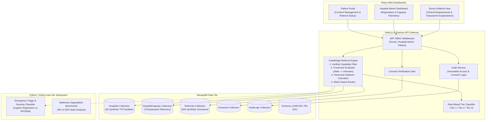

# CareBridge: Capability-Verified, Freshness-Aware Hospital Referral Platform

> **RESEARCH PROTOTYPE NOTICE & CLINICAL DISCLAIMER:**  
> **Decision support only. A clinician must review.**  
> CareBridge is a health-informatics research prototype designed for evaluating capability-verified, freshness-aware referral engines in Tamil Nadu, India. All clinical and hospital records are synthetic. CareBridge does NOT make clinical diagnoses or replace clinical judgement, and makes no unsubstantiated claims of improved medical outcomes, reduced delays, or cost reduction.

---

## 1. Project Overview & One-Sentence Research Contribution

> **Core Research Contribution:**  
> A referral engine that ranks hospitals by **verified clinical capability first**, then capacity and distance, and treats **stale or missing capacity data as "unknown"** rather than "available".

Conventional referral systems frequently succumb to two fundamental pitfalls:
1. **The Proximity Fallback Fallacy**: Defaulting to the nearest hospital regardless of whether it actually possesses the required specialist, ventilator, or catheterization lab.
2. **The Staleness Assumption Fallacy**: Treating out-of-date bed numbers as currently "available", resulting in futile emergency transfers and patient diversions.

CareBridge addresses these challenges through transparent rule-based capability verification, dynamic telemetry staleness thresholds, and freshness-aware rank scoring.

---

## 2. System Architecture



---

## 3. Architecture Decision Records (ADRs)

### ADR-001: Rule-Based Matching for Referral Ranking
- **Context**: Selecting recipient hospitals for high-acuity patients requires strict adherence to clinical standards (e.g., patient requiring invasive ventilation cannot be sent to a hospital with 0 ventilators).
- **Decision**: Implement a **deterministic, rule-based capability filter** followed by transparent multi-criteria ranking rather than a black-box machine learning recommender.
- **Rationale**: 
  - Clinical explainability is paramount: Clinicians need explicit reasons ("Has Pulmonologist on-call 24x7, 4 ICU beds verified 35m ago, 18.2 km via Haversine").
  - Zero tolerance for hallucinated capabilities: Machine learning models can recommend non-equipped facilities based on spurious correlations.
  - Transparent policy weights enable rigorous sensitivity and staleness analysis.

### ADR-002: Document Database with MongoDB & Mongoose
- **Context**: Hospital clinical capacities, equipment inventories, and telemetry snapshots feature nested structures and frequent updates.
- **Decision**: Use MongoDB with structured Mongoose schemas and strict schema-level validation.
- **Rationale**:
  - Flexible subdocuments for complex equipment matrices (`ventilators`, `cardiacCathLab`, `bloodBank`) and timestamped capacity snapshots.
  - Geospatial indexing support for coordinates in Tamil Nadu.
  - In-memory embedded fallback (`mongodb-memory-server`) ensures the prototype runs seamlessly without mandatory external daemon setup.

### ADR-003: Stateless JWT with Role-Based Access Control (RBAC)
- **Context**: CareBridge handles simulated patient records and sensitive referral actions across three distinct stakeholder personas: `patient`, `doctor`, and `hospital_admin`.
- **Decision**: Use signed JSON Web Tokens (JWT) containing actor role and hospital affiliation, verified server-side on every protected endpoint.
- **Rationale**:
  - Secure, tamper-proof role assertion.
  - Server-side consent checks verify resource authorization independent of client-provided IDs.

### ADR-004: Freshness-Aware Semantics (Stale = "Unknown")
- **Context**: Telemetry from hospitals often goes stale due to network interruptions or administrative delays. Naive systems treat stale data as currently available.
- **Decision**: Enforce a configurable `stalenessThresholdMinutes` (default 120 minutes). If telemetry timestamp exceeds this threshold, effective capacity is evaluated as `'unknown'`.
- **Rationale**:
  - Treating stale capacity as "available" causes futile emergency transfers.
  - Treating stale data as "unknown" penalizes stale hospitals in ranking, incentivizing timely telemetry reporting.

---

## 4. Repository Structure

```
carebridge/
├── backend/
│   ├── data/                                 # Exported synthetic benchmark datasets
│   │   ├── synthetic_hospitals.json          # 40 Tamil Nadu synthetic hospitals
│   │   ├── synthetic_referral_scenarios.json # 500 scenarios with ground-truth
│   │   └── synthetic_schemes.json            # CMCHIS and PM-JAY catalogue
│   ├── src/
│   │   ├── config/
│   │   │   └── db.js                         # DB connector (MongoDB / MongoMemoryServer)
│   │   ├── models/
│   │   │   ├── Hospital.js                   # Capabilities, equipment, beds, status, tier
│   │   │   ├── HospitalCapacity.js           # Timestamped beds & freshness evaluation
│   │   │   ├── Referral.js                   # Clinical requirements & recommendation items
│   │   │   ├── Consent.js                    # Patient record sharing authorizations
│   │   │   ├── AuditLog.js                   # Immutable access & action logs
│   │   │   ├── User.js                       # JWT auth & role definitions
│   │   │   └── Scheme.js                     # Health assurance scheme metadata
│   │   ├── scripts/
│   │   │   ├── syntheticDataGenerator.js     # Deterministic TN synthetic generator
│   │   │   └── seed.js                       # Seeding and benchmark export script
│   │   └── tests/
│   │       └── phase1.test.js                # Schema, staleness & seed unit tests
│   └── package.json
├── ml/                                       # ML severity model & staleness experiments
├── frontend/                                 # React dashboards
├── docs/                                     # Research notes and evaluation charts
└── README.md
```

---

## 5. Phase 1 Verification & How to Run

### Run Unit Tests
```bash
cd backend
npm test
```
All 11 Phase 1 unit tests validate:
- Hospital schema validation and Tamil Nadu coordinate boundary checks.
- HospitalCapacity staleness detection and evaluation (`stale -> unknown`).
- Baseline comparison mode (`assumeAvailableIfStale`).
- Consent expiration logic and AuditLog immutability.
- Synthetic generation of 40 Tamil Nadu hospitals and 500 ground-truth scenarios.

### Run Seed Script
```bash
cd backend
npm run seed
```
This populates the database and exports `synthetic_hospitals.json`, `synthetic_referral_scenarios.json`, and `synthetic_schemes.json` into `backend/data/`.

---

## 6. Phase 2: Hospital Registration, Verification Workflow & Rule-Based Tiering

### 6.1 Proposed Capability Tier Rules (`config/tierRules.json`)
> **Important Research Note**: These tiers are **proposed research categories** for clinical decision support, **NOT** official statutory or government classifications. Tier indicates institutional infrastructure and does **NOT** equal patient suitability (patient referral matching is evaluated separately in Phase 3).

| Capability Tier | Category Label | Minimum Clinical Criteria |
| :--- | :--- | :--- |
| **Tier 1** | Advanced Tertiary / Quaternary | 24x7 Emergency Service, ICU Beds $\ge 20$, Ventilators $\ge 10$, CT Scanner, MRI Scanner, Clinical Laboratory, Operation Theatres $\ge 3$, Specialties $\ge 8$. |
| **Tier 2** | Secondary Referral / District Center | Inpatient Beds (General + Emergency + ICU) $\ge 30$, Clinical Laboratory, Diagnostic X-ray, Ultrasound Imaging, Operation Theatres $\ge 1$, Specialties $\ge 3$. |
| **Tier 3** | Basic Community Stabilization | Registered healthcare facility with basic stabilization and primary outpatient services. |

- **Effective vs. Unconfirmed Tiers**: Only a `verified` hospital receives an effective `confirmed` tier. Hospitals with `unverified` or `pending` status display their proposed tier clearly labeled `unconfirmed`.
- **Automatic Re-Classification**: Any edit to capability-defining fields (`specialties`, `equipment`, `bedCounts`, `has24x7Emergency`, `departments`) automatically re-runs tier evaluation and resets `verificationStatus` to `pending`.

### 6.2 Simulated Verification Workflow & States
```
[unverified] ──(submit-for-verification)──> [pending] ──(verify: reviewer)──> [verified]
                                               │
                                               └──(reject: reviewer)──> [rejected]
```
- **Simulated Consistency Checks**:
  Upon submission, the verification engine checks:
  1. Registration and license number formatting.
  2. Presence of mandatory compliance document metadata (`hospital_license` or `clinical_establishment_reg`).
  3. Internal clinical capability consistency (e.g., claiming CT/MRI without Radiology department or specialist; claiming ICU beds with zero mechanical ventilators; claiming 24x7 Emergency with zero emergency beds).
- **Protected Evidence Storage**: Evidence document metadata is maintained in MongoDB while simulated binary files are isolated in `storage/evidence/` with server-side authorization gates.
- **Authenticity Disclaimer**: Automated verification checks format and internal data consistency. It does **NOT** certify legal authenticity or physical presence, which in production requires cryptographic integration with the Tamil Nadu Clinical Establishments Act registry.

### 6.3 ADR-005: Rule-Based Tier Classification via External Configuration
- **Context**: Institutional capability criteria evolve as clinical guidelines, equipment mandates, and health policies shift across districts. Hardcoding thresholds in application code causes brittle deployments and opaque evaluations.
- **Decision**: Define institutional capability thresholds in an external configuration schema (`config/tierRules.json`) and evaluate them using a pure, deterministic function (`tierClassificationService.js`) returning `rulesMet`, `rulesMissed`, and `gapToNextTier`.
- **Rationale**:
  - Fully transparent and auditable: Clinicians, hospital administrators, and reviewers can view exact requirements and deficits.
  - Policy flexibility: Thresholds can be tuned or versioned without modifying core referral engine logic.
  - Deterministic evaluation: Guarantees repeatable classification without heuristic drift or ML hallucinations.

---

## 7. How to Run & Test Phase 2

### Run Full Test Suite
```bash
cd backend
npm test
```
All 27 unit and integration tests validate:
- Pure deterministic tier classification, boundary conditions (ICU beds 19 vs 20), and equipment deficit fallbacks.
- Input validation: negative bed rejection, ICU bed limits, Tamil Nadu bounding box compliance, unique registration numbers.
- Strict server-side ownership: `hospital_admin` cannot read or edit other hospitals; only `platform_reviewer` can verify or reject.
- Workflow transitions: capability edits reset verification status to `pending`; rejection requires an explicit reason.
- Consistency checks: cross-sectional imaging without radiology and ventilator-free ICUs generate automated warnings.

### Run Seed Script
```bash
cd backend
npm run seed
```
Creates 40 synthetic hospitals classified through `classifyHospitalTier()` and seeds 5 demo accounts.

### Start the Backend Server
```bash
cd backend
npm start
# Server listens on http://localhost:5000
```

### Example API Requests (curl)

#### 1. Login as Platform Reviewer
```bash
curl -X POST http://localhost:5000/api/auth/login \
  -H "Content-Type: application/json" \
  -d '{"email":"reviewer@carebridge.tn.gov.in","password":"ReviewerPassword123!"}'
```

#### 2. Register a Hospital (`hospital_admin`)
```bash
curl -X POST http://localhost:5000/api/hospitals \
  -H "Content-Type: application/json" \
  -H "Authorization: Bearer <ADMIN_JWT_TOKEN>" \
  -d '{
    "name": "Synthetic Erode Heart & Lung Centre",
    "registrationNumber": "CEA-TN-2026-999",
    "district": "Erode",
    "location": {"latitude": 11.3410, "longitude": 77.7172},
    "ownership": "private_trust",
    "has24x7Emergency": true,
    "specialties": ["Cardiology", "Pulmonology", "Emergency Medicine"],
    "bedCounts": {"general": 50, "emergency": 10, "icu": 8},
    "equipment": {
      "ventilators": {"available": true, "count": 6},
      "xray": {"available": true, "count": 1},
      "ultrasound": {"available": true, "count": 1},
      "operationTheatres": {"available": true, "count": 2},
      "lab": {"available": true, "level": "advanced"}
    }
  }'
```

#### 3. Submit Hospital for Verification (`hospital_admin`)
```bash
curl -X POST http://localhost:5000/api/hospitals/<HOSPITAL_ID>/submit-for-verification \
  -H "Authorization: Bearer <ADMIN_JWT_TOKEN>" \
  -H "Content-Type: application/json" \
  -d '{"notes":"Annual compliance renewal submission"}'
```

#### 4. Approve and Verify Hospital (`platform_reviewer`)
```bash
curl -X POST http://localhost:5000/api/hospitals/<HOSPITAL_ID>/verify \
  -H "Authorization: Bearer <REVIEWER_JWT_TOKEN>" \
  -H "Content-Type: application/json" \
  -d '{"reason":"Physical inspection and biomedical certificate audit verified."}'
```

---

## 8. Phase 3: Freshness-Aware Referral Engine, Baselines & Evaluation

### 8.1 Engine Architecture & 5-Step Pure Pipeline
The CareBridge referral engine is implemented as a **pure, deterministic function** (`services/referralEngineService.js`) with zero database calls inside the algorithm, making it repeatable, auditable, and testable.

```mermaid
graph TD
    Input["Input: Required Specialty, Urgency, Equipment, Bed Type, Patient GPS, Referring Facility"]
    
    subgraph Step1["Step 1: Clinical Hard Filters (Failure = Hard Exclusion)"]
        F1["1. Verification Status = verified"]
        F2["2. Exclude Originating Referring Hospital"]
        F3["3. Possesses Required Specialty & Specialist Count > 0"]
        F4["4. Possesses All Required Equipment"]
        F5["5. 24x7 Emergency Service (if urgency = emergency)"]
        F6["6. Required Bed Type NOT Freshly Reported 'unavailable'"]
    end
    
    subgraph Step2["Step 2: Capacity Freshness Evaluation"]
        Fresh["effectiveState = age <= maxAge ? reportedState : 'unknown'"]
    end
    
    subgraph Step3["Step 3: Distance Calculation"]
        Dist["Haversine Straight-Line Distance (km)"]
    end
    
    subgraph Step4["Step 4: Transparent Multi-Criteria Weighted Scoring"]
        S1["Clinical Suitability (0.40 - 0.50): Capability fit + specialist depth"]
        S2["Capacity State (0.35): Available=1.0, Unknown=0.3, Unavailable=0.0"]
        S3["Distance (0.15 - 0.25): Inverted Haversine (higher weight for emergency)"]
        S4["Scheme Bonus (0.02): Tie-breaker for CMCHIS / PM-JAY"]
    end
    
    subgraph Step5["Step 5: Deterministic Tie-Breaking"]
        Sort["Sort by: Total Score DESC -> Distance ASC -> Hospital ID ASC"]
    end
    
    Input --> Step1
    Step1 -->|Eligible Pool| Step2
    Step2 --> Step3
    Step3 --> Step4
    Step4 --> Step5
    Step5 --> Output["Ranked Recommendations + Excluded List + Explanations"]
```



### 8.2 Weight Rationale (`config/rankingRules.json`)
The weighting distribution reflects clinical reality across three distinct triage urgency tiers:
- **Emergency**: Distance weight increases to **0.25** ($w_{\text{clin}} = 0.40, w_{\text{cap}} = 0.35, w_{\text{dist}} = 0.25$) because rapid stabilization and transport proximity are life-critical.
- **Urgent**: Balanced weighting ($w_{\text{clin}} = 0.45, w_{\text{cap}} = 0.35, w_{\text{dist}} = 0.20$).
- **Routine**: Clinical suitability dominates at **0.50** ($w_{\text{clin}} = 0.50, w_{\text{cap}} = 0.35, w_{\text{dist}} = 0.15$), where travel distance is secondary to specialist depth.
- **Capacity Scoring**: `available = 1.0`, `unknown = 0.3`, `unavailable = 0.0`. Stale or unverified telemetry never achieves parity with fresh availability.
- **Scheme Bonus**: +0.02 added solely as a tie-breaker when requested by the clinician.
- **Hospital Tier Independence**: Hospital tier is deliberately **NOT** a direct input to ranking. A Tier 2 secondary hospital with an on-call specialist and available bed will rightfully outrank a Tier 1 quaternary facility lacking that specialist or operating under total bed diversion.

### 8.3 Telemetry Freshness Rules (`config/freshness.json`)
Telemetry staleness thresholds scale with patient acuity:
- **Emergency Urgency**: Maximum age = **120 minutes (2 hours)**.
- **Urgent Urgency**: Maximum age = **360 minutes (6 hours)**.
- **Routine Urgency**: Maximum age = **1440 minutes (24 hours)**.
- **Unreported Facilities**: Any hospital that has never reported capacity telemetry is strictly treated as `'unknown'`, never `'available'`.

### 8.4 Baseline Recommenders
CareBridge was benchmarked against four representative baselines:
1. **`nearestVerified`**: Sorts verified hospitals strictly by minimum straight-line distance, completely ignoring clinical specialty, equipment, or bed state.
2. **`alwaysTier1`**: Selects the nearest verified Tier 1 quaternary hospital, representing the common clinical bias toward top-tier referral centers.
3. **`randomEligible`**: Selects a random facility passing the clinical hard filters (reproducible seeded pseudo-random shuffle).
4. **`nearestEligible`**: Passes all clinical capability hard filters, but sorts strictly by minimum distance, ignoring real-time capacity and freshness. This strong baseline isolates the exact value of CareBridge's multi-criteria capacity-aware ranking.

### 8.5 Ground-Truth Construction & Research Limitations
- **Construction**: Across 500 evaluation scenarios, a hidden **TRUE network state** is maintained for every facility (actual beds and emergency intake operational status). A hospital belongs to the ground-truth suitable set if and only if: (1) verified, (2) possesses required specialty, (3) possesses all required equipment, (4) satisfies 24x7 emergency mandate if emergency urgency, and (5) **actually has available capacity in the hidden true state**.
- **Challenging Scenarios Injected**:
  - *Hard Type A (Remote)*: Remote patient location where all suitable facilities are $>100\text{ km}$ away.
  - *Hard Type B (Specialist Deficit)*: Nearest verified facility lacks the required specialty.
  - *Hard Type C (Tier 1 Saturation)*: Major regional Tier 1 hospital has 0 available beds in the hidden true state.
- **Limitation Disclosure**: Ground-truth capability requirements mirror the engine's hard filters; thus, capability-match is $100\%$ by construction for methods respecting eligibility. The informative comparison lies in **Top-1 suitability** (combining capability with true real-time bed capacity) and performance under degraded telemetry freshness (Phase 4).

### 8.6 Benchmark Results (0% Staleness, 500 Scenarios)

```
--- RESEARCH EVALUATION RESULTS TABLE (0% Staleness) ---
| Model / Method     | Cap Match (%) | Top-1 Suit (%) | Top-3 Hit (%) |   MRR   | False Avail (%) | Mean Dist (km) | Latency (ms) |
| :----------------- | ------------: | -------------: | ------------: | ------: | --------------: | -------------: | -----------: |
| CareBridge (Ours)  |          100% |           100% |          100% |   1.000 |              0% |        24.8 km |      0.13 ms |
| Nearest Eligible   |          100% |            71% |         97.6% |   0.839 |              0% |        14.8 km |      0.03 ms |
| Nearest Verified   |         71.2% |          50.2% |         84.6% |   0.692 |              0% |        14.2 km |      0.04 ms |
| Always Tier 1      |          100% |          67.6% |         93.4% |   0.809 |              0% |        17.9 km |      0.02 ms |
| Random Eligible    |         99.4% |          68.6% |         95.4% |   0.819 |              0% |       221.8 km |      0.02 ms |
--------------------------------------------------------
```

### 8.7 ADR-006: Transparent Multi-Criteria Ranking & First-Class "Unknown" State
> **Decision**: Rank recipient hospitals using explicit, transparent multi-criteria weights where capacity staleness maps directly into a dedicated, penalized `'unknown'` state (score $0.3$) rather than binary availability ($1.0$ or $0.0$).  
> **Rationale**: In emergency health informatics, unverified assumptions lead to ambulance diversions. Treating stale or missing data as "available" causes transfer failures; treating it as "unavailable" prematurely excludes viable regional facilities. Treating `'unknown'` as a distinct first-class state penalizes the hospital in ranking while generating explicit clinical warnings (`"Capacity unknown: confirm availability by telephone before dispatch"`), keeping clinicians informed and incentivizing hospitals to transmit timely capacity telemetry.

---

## 9. How to Run Phase 3

### 1. Run Complete Test Suite
```bash
cd backend
npm test
```
Executes all 46 unit and integration tests across Phase 1, Phase 2, and Phase 3:
- Haversine straight-line distance accuracy, symmetry, and zero-distance.
- Capacity freshness boundary conditions (119m vs 121m) and never-reported evaluation.
- Referral engine hard filters (verification, specialty, equipment, 24x7 emergency, bed availability).
- Ranking rules: Tier 2 outranking Tier 1 without specialist; fresh available outranking stale unknown; deterministic tie-breaks.
- `capacityMode` toggle (`unknown_aware` vs `assume_available`).
- Role-based referral access control (patients view own status only; doctors cannot inspect other clinicians' referrals).

### 2. Run the Benchmark Evaluation Script
```bash
cd backend
npm run evaluate
```
Runs 500 scenarios across all 5 models and saves reports to `backend/src/evaluation/results/evaluation_results_0pct_staleness.json` and `.csv`.

### 3. Example API Calls & Worked Emergency Referral Workflow

#### A. Submit Capacity Snapshot (`hospital_admin`, Own Hospital Only)
```bash
curl -X PUT http://localhost:5000/api/hospitals/<HOSPITAL_ID>/capacity \
  -H "Authorization: Bearer <ADMIN_JWT_TOKEN>" \
  -H "Content-Type: application/json" \
  -d '{
    "reportedAt": "2026-10-12T10:30:00.000Z",
    "beds": {
      "general": { "total": 120, "occupied": 95, "available": 25, "reportedStatus": "available" },
      "emergency": { "total": 20, "occupied": 16, "available": 4, "reportedStatus": "available" },
      "icu": { "total": 15, "occupied": 13, "available": 2, "reportedStatus": "available" },
      "ventilators": { "total": 10, "occupied": 8, "available": 2, "reportedStatus": "available" }
    },
    "services": {
      "emergencyDepartment": { "reportedStatus": "available", "diversionActive": false },
      "ctScan": { "reportedStatus": "available" },
      "mri": { "reportedStatus": "available" },
      "operatingTheatre": { "reportedStatus": "available" }
    },
    "specialistsOnCall": ["Pulmonology", "Cardiology", "Emergency Medicine"],
    "stalenessThresholdMinutes": 120
  }'
```

#### B. Generate Emergency Referral Recommendation (`doctor`)
```bash
curl -X POST http://localhost:5000/api/referrals/recommend \
  -H "Authorization: Bearer <DOCTOR_JWT_TOKEN>" \
  -H "Content-Type: application/json" \
  -d '{
    "patientName": "Synthetic ARDS Emergency Case",
    "requiredSpecialty": "Pulmonology",
    "urgency": "emergency",
    "requiredEquipment": ["ventilators"],
    "requiredBedType": "icu",
    "patientLocation": {"latitude": 11.6643, "longitude": 78.1460},
    "preferredScheme": "CMCHIS"
  }'
```

##### Worked Example Output
```json
{
  "message": "Referral recommendations generated. Draft saved for clinical review.",
  "referralId": "REF-738921-504",
  "status": "draft",
  "decisionSupportNotice": "Decision support only. A clinician must review.",
  "summary": {
    "totalHospitalsEvaluated": 40,
    "eligibleCount": 4,
    "excludedCount": 36,
    "capacityMode": "unknown_aware",
    "urgency": "emergency",
    "requiredSpecialty": "Pulmonology"
  },
  "recommendations": [
    {
      "rank": 1,
      "hospitalId": "670a41...",
      "name": "Synthetic - Salem Apex Heart & Critical Care Institute",
      "district": "Salem",
      "tier": "Tier 1",
      "effectiveTier": "Tier 1",
      "score": 0.9854,
      "distanceKm": 3.82,
      "distanceNotice": "Straight-line distance, not travel time",
      "capacityState": "available",
      "capacityAgeLabel": "ICU data 28m old (fresh)",
      "matchedCapabilities": ["Pulmonology (2 specialists, 24x7 on-call)", "ventilators"],
      "schemeMatched": true,
      "explanation": "Verified Tier 1. Has Pulmonology (2 specialists, 24x7 on-call). ICU capacity is available (ICU data 28m old (fresh)). 3.82 km straight-line distance (Straight-line distance, not travel time). Empaneled under CMCHIS (potential match, verify eligibility)."
    }
  ],
  "excludedHospitals": [
    {
      "hospitalId": "670a42...",
      "name": "Synthetic Primary Health Centre",
      "exclusionReasons": ["Lacks required specialty: Pulmonology", "Lacks required equipment: ventilators"]
    }
  ]
}
```

#### C. Review and Accept Recommendation (`doctor`)
```bash
curl -X PATCH http://localhost:5000/api/referrals/<REFERRAL_DOC_ID>/review \
  -H "Authorization: Bearer <DOCTOR_JWT_TOKEN>" \
  -H "Content-Type: application/json" \
  -d '{
    "selectedHospitalId": "<HOSPITAL_ID>",
    "newStatus": "reviewed",
    "notes": "Patient unstable with SpO2 84% on mask. Contacted Salem Apex ICU charge nurse. Transfer coordinated via 108 ambulance."
  }'
```

#### D. Patient Viewing Referral Status (`patient`)
```bash
curl -X GET http://localhost:5000/api/referrals/<REFERRAL_DOC_ID> \
  -H "Authorization: Bearer <PATIENT_JWT_TOKEN>"
```
*Note: Clinical ranking scores and excluded hospital matrices are automatically stripped for patient privacy and clarity.*

---

## 10. Phase 3 Done Checklist

| Item | Requirement | Status | Verification Reference |
| :--- | :--- | :---: | :--- |
| **1. Capacity Telemetry API** | `PUT /api/hospitals/:id/capacity` (own hospital only, append-only, audit-logged) | Completed | `routes/capacityRoutes.js` + `phase3.test.js` |
| **2. Freshness Engine** | Configurable urgency thresholds (`freshness.json`), stale $\to$ `"unknown"`, human age label | Completed | `services/freshnessService.js` + `phase3.test.js` |
| **3. Referral Engine (Pure)** | Deterministic 5-step pipeline, 0 database calls in core engine | Completed | `services/referralEngineService.js` + `phase3.test.js` |
| **4. Distance Calculation** | Haversine formula with mandatory label: *"straight-line distance, not travel time"* | Completed | `services/haversineService.js` + `phase3.test.js` |
| **5. Transparent Ranking** | `rankingRules.json`: clinical fit, capacity, distance, scheme tie-breaker, tier independent | Completed | `config/rankingRules.json` + `phase3.test.js` |
| **6. Capacity Modes** | `unknown_aware` (default) and `assume_available` (Phase 4 comparison mode) | Completed | `referralEngineService.js` + `phase3.test.js` |
| **7. Clinical Disclaimer** | Top-level notice: *"Decision support only. A clinician must review."* on all outputs | Completed | All responses and engine outputs |
| **8. Referral Workflow API** | `POST /api/referrals/recommend`, `GET /api/referrals/:id`, `PATCH /api/referrals/:id/review` | Completed | `routes/referralRoutes.js` + `phase3.test.js` |
| **9. Baselines** | `nearestVerified`, `alwaysTier1`, `randomEligible`, `nearestEligible` | Completed | `src/evaluation/baselines/` |
| **10. Synthetic Evaluation** | 500 scenarios with hidden true vs observed state, hard scenarios injected | Completed | `src/evaluation/scenarioGenerator.js` |
| **11. Evaluation Benchmark** | `npm run evaluate`, CSV + JSON reports in `evaluation/results/` | Completed | `src/evaluation/evaluate.js` |
| **12. Test Suite** | 46 passing tests covering Haversine, freshness, hard filters, ranking, and RBAC | Completed | `npm test` (3 test suites, 46/46 passed) |

---

## 11. Phase 4: Telemetry Staleness Experiments & Empirical Findings

### 11.1 The Core Research Question & Simulation Model
> **Research Question (RQ)**: How does stale or missing hospital capacity data affect referral recommendation quality, and does treating stale data as **"unknown"** reduce harmful errors compared with treating it as **"available"**?

The experiment simulates capacity degradation across $s \in \{0\%, 10\%, 20\%, 30\%, 40\%, 50\%\}$ of network facilities using three distinct mechanisms:
- **Mechanism A (Aged Reports)**: Telemetry timestamp exceeds urgency freshness threshold ($>120\text{m}$ for emergency).
- **Mechanism B (Missing Reports)**: Hospital has never reported telemetry (unregistered/disconnected).
- **Mechanism C (Mixed)**: 50% aged reports, 50% missing reports (primary evaluation mechanism).

#### The Drift Model: Why "Assume Available" is Dangerous
For aged reports, the hidden true network state may have changed since the report was filed with probability $p_{\text{drift}} = 0.30$ (sensitivity tested at $0.10$ and $0.50$).  
Specifically, an aged report filed 4 hours ago may have recorded beds as `available`, but during the elapsed time those beds became occupied. When a naive referral engine assumes available or trusts stale data without discounting, it dispatches critical emergency patients to fully saturated facilities (**false-available error**).

### 11.2 Empirical Benchmark Results (30 Independent Test Seeds, 500 Scenarios/Seed)

```
--- PHASE 4 EMPIRICAL BENCHMARK RESULTS (Mixed Mechanism, 30 Test Seeds) ---
| Staleness | Referral Model / Strategy | Telemetry Handling | False-Avail Rate (95% CI) | Top-1 Suitable Rate (95% CI) | Top-3 Hit Rate | Mean Dist. |
| :---: | :--- | :--- | :---: | :---: | :---: | :---: |
| 0% | CareBridge (unknown_aware) | Fresh evaluated (stale -> unknown) | 0.0% [0.0, 0.0] | 100.0% [100.0, 100.0] | 100.0% | 24.8 km |
| 0% | CareBridge (assume_available) | Naive: Stale/missing -> available | 0.0% [0.0, 0.0] | 100.0% [100.0, 100.0] | 100.0% | 24.8 km |
| 0% | Nearest Eligible | Ignored (minimum distance) | 29.0% [29.0, 29.0] | 71.0% [71.0, 71.0] | 97.6% | 14.8 km |
| 0% | Nearest Verified | Ignored (proximity only) | 27.8% [27.8, 27.8] | 50.2% [50.2, 50.2] | 84.6% | 14.2 km |
| 0% | Always Tier 1 | Ignored (nearest Tier 1 hub) | 32.4% [32.4, 32.4] | 67.6% [67.6, 67.6] | 93.4% | 17.9 km |
| 20% | CareBridge (unknown_aware) | Fresh evaluated (stale -> unknown) | 0.0% [0.0, 0.0] | 100.0% [100.0, 100.0] | 100.0% | 33.6 km |
| 20% | CareBridge (assume_available) | Naive: Stale/missing -> available | 9.3% [8.9, 9.7] | 90.7% [90.3, 91.1] | 99.8% | 22.5 km |
| 20% | CareBridge (trust_last_reported) | Historical: Unadjusted snapshot | 2.0% [1.8, 2.1] | 98.0% [97.9, 98.2] | 100.0% | 29.4 km |
| 50% | CareBridge (unknown_aware) | Fresh evaluated (stale -> unknown) | 0.0% [0.0, 0.0] | 100.0% [100.0, 100.0] | 100.0% | 60.4 km |
| 50% | CareBridge (assume_available) | Naive: Stale/missing -> available | 19.3% [18.9, 19.6] | 80.8% [80.4, 81.1] | 98.6% | 20.0 km |
| 50% | CareBridge (trust_last_reported) | Historical: Unadjusted snapshot | 5.4% [5.0, 5.8] | 94.6% [94.2, 95.0] | 100.0% | 40.0 km |
```

- **H1 Confirmed**: Naive `assume_available` false-available rate escalated to **19.3%** at 50% staleness, whereas `unknown_aware` maintained **0.0%** false availability ($p < 0.0001$, paired Wilcoxon test; Cliff's $\delta = -1.000$).
- **H2 Trade-off Quantified**: `unknown_aware` avoids false-available dispatches by expanding its search radius for fresh confirmed capacity (mean straight-line distance increased from **24.8 km** to **60.4 km**).
- **H3 Confirmed**: Both capacity-aware modes substantially outperformed standard heuristics (`Nearest Verified`: 50.2% suitable; `Always Tier 1`: 67.6% suitable).

### 11.3 ADR-007: Treating Capacity Telemetry as a First-Class "Unknown" State
> **Decision**: In automated decision support, capacity telemetry exceeding urgency freshness limits or facilities lacking reports must be represented as a dedicated, first-class `'unknown'` state with a penalized score ($0.3$), rather than defaulting to binary availability ($1.0$ or $0.0$).  
> **Rationale**: Binary assumptions in health informatics fail in opposite directions: assuming available causes ambulance diversions to filled facilities; assuming unavailable prematurely excludes regional hospitals. Treating `'unknown'` as a first-class state surfaces transparent warnings to the clinician (*"Capacity unknown: confirm availability by telephone prior to transfer dispatch"*), protecting clinical safety while keeping all eligible facilities visible for clinician override.

### 11.4 How to Run Phase 4

```bash
# Run the complete test suite (all 60 unit & integration tests)
cd backend
npm test

# Run the Phase 4 full factorial benchmark experiment (30 test seeds, 500 scenarios)
npm run experiment
```

- **Raw Data**: `backend/src/evaluation/results/staleness_raw.csv`
- **Aggregated Summaries**: `backend/src/evaluation/results/staleness_summary.csv` and `.json`
- **Publication Figures**: `docs/plots/` and `backend/src/evaluation/results/plots/`
- **Preregistration**: `evaluation/PREREGISTRATION.md`
- **Detailed Discussion**: `evaluation/RESULTS.md`

---

## 12. Phase 4 Done Checklist

| Item | Requirement | Status | Verification Reference |
| :--- | :--- | :---: | :--- |
| **1. Preregistration** | Locked `PREREGISTRATION.md` with hypotheses H1–H3, primary/secondary metrics | Completed | `evaluation/PREREGISTRATION.md` |
| **2. Staleness Simulation** | Levels $s \in \{0, 10, 20, 30, 40, 50\}\%$, 3 mechanisms (aged, missing, mixed), seed determinism | Completed | `src/evaluation/staleness/stalenessModel.js` |
| **3. Drift Model** | Parameterized $p_{\text{drift}} \in \{0.1, 0.3, 0.5\}$, $s=0 \implies \text{observed} == \text{true}$ asserted | Completed | `stalenessModel.js` + `phase4.test.js` |
| **4. Modes Compared** | `unknown_aware`, `assume_available`, `trust_last_reported`, plus 4 baselines | Completed | `experimentRunner.js` |
| **5. Experiment Runner** | `npm run experiment` running 30 disjoint test seeds over 500 scenarios | Completed | `src/evaluation/experimentRunner.js` |
| **6. Bootstrap CIs & Stats** | 95% bootstrap CIs, paired differences, Wilcoxon signed-rank tests, Cliff's delta | Completed | `src/evaluation/metrics.js` |
| **7. Sensitivity Analyses** | Drift probabilities, biased staleness, threshold variations | Completed | `experimentRunner.js` + `RESULTS.md` |
| **8. Publication Plots** | 5 figures generated in both vector SVG and 24-bit PNG with shaded CI bands | Completed | `docs/plots/` and `evaluation/results/plots/` |
| **9. Summary Tables** | Formatted Markdown and LaTeX tables at 0%, 20%, 50% staleness | Completed | `RESULTS.md` and console output |
| **10. Results Write-up** | `RESULTS.md` discussing H1–H3, distance trade-off, limitations, permitted claims | Completed | `evaluation/RESULTS.md` |
| **11. Unit Test Suite** | 14 Phase 4 tests (all 60 suite tests passing across all 4 phases) | Completed | `npm test` (4 test suites, 60/60 passed) |


