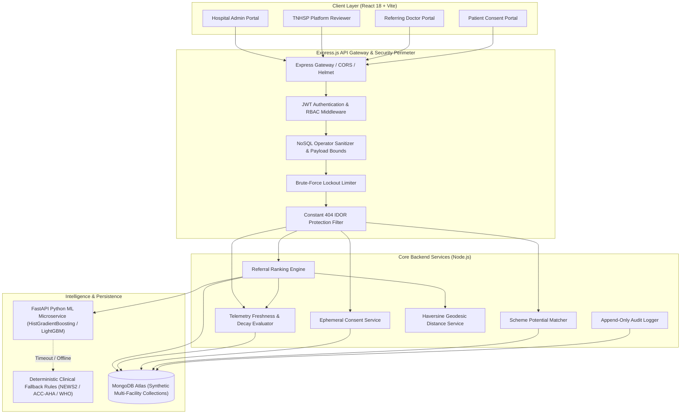
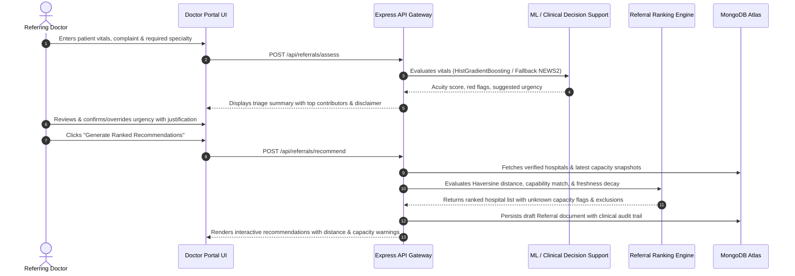
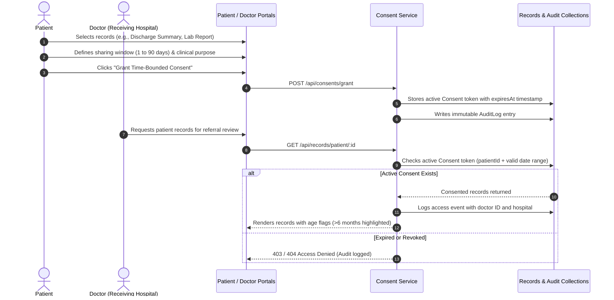

# CareBridge: Architecture Documentation & Architectural Decision Records (ADRs)

*Version: Phase 7 Final Integration*  
*Target Environment: Simulated Tamil Nadu Regional Referral Network*  

---

## 1. System Overview & Technology Stack

CareBridge is engineered as a decoupled, multi-tier health informatics platform designed for high-availability clinical decision support:

---

## 2. End-to-End Clinical Data Flows

### 2.1 Clinical Intake, Acuity Triage & Referral Generation Flow

### 2.2 Patient Consent & Cross-Hospital Record Exchange Flow

---

## 3. Consolidated Architecture Decision Records (ADRs 001–011)

### ADR-001: Separate Hospital Registration from Operational Telemetry
- **Status**: Accepted & Implemented (Phase 2 & Phase 3)
- **Context**: Hospitals have static infrastructural properties (district, GPS location, CEA registration number, empaneled specialties) and dynamic operational states (open emergency beds, available ICU beds, staffed ventilators). Coupling these in a single mutable document causes telemetry race conditions, schema bloat, and loss of historical auditing.
- **Decision**: Persist static profile data in `hospitals` and dynamic status updates as immutable, time-stamped events in a dedicated `hospital_capacity` collection. Query the latest snapshot via an indexed aggregation pipeline (`$sort: { timestamp: -1 }`).
- **Consequences**: Telemetry writes do not lock the hospital directory; audit trails are naturally preserved; time-series decay analysis is trivial to compute.

---

### ADR-002: Capability Verification & Unconfirmed Tier Demotion
- **Status**: Accepted & Implemented (Phase 2 & Phase 7)
- **Context**: In unvetted hospital registries, peripheral or private facilities frequently self-report as "Tier 1 Quaternary" centers to attract complex referrals, risking patient transfer failures when advanced care is absent.
- **Decision**: All newly registered hospitals or newly claimed specialties remain in an `unverified` status until an authorized Platform Reviewer explicitly signs off. If an unverified hospital attempts to capture high-acuity referrals, its effective tier is automatically demoted to Tier 3 in the ranking engine.
- **Consequences**: Prevents unvetted centers from receiving emergent patients requiring intensive surgical or respiratory interventions.

---

### ADR-003: Haversine Straight-Line Distance with Explicit Road Network Caveat
- **Status**: Accepted & Implemented (Phase 3 & Phase 7)
- **Context**: While real-time driving routes via third-party APIs (Google Maps, Mapbox) offer road-network accuracy, third-party network calls introduce rate limits, latency spikes (>500ms), and API key dependencies that compromise pure algorithmic reproducibility.
- **Decision**: Compute straight-line geodesic distance via the pure, deterministic Haversine formula directly in JavaScript. Require an explicit, ubiquitous UI and API disclaimer stating that distance is straight-line and road transit time will vary.
- **Consequences**: Deterministic sub-millisecond ranking latency (<1ms); zero external API dependency; transparent and honest clinical disclosure.

---

### ADR-004: Freshness-Aware Telemetry Decay (`unknown_aware` Mode)
- **Status**: Accepted & Implemented (Phase 3 & Phase 4)
- **Context**: Digital dashboards naively assume that bed counts reported hours or days ago remain valid until updated. In rapid turnover emergency departments, this creates "ghost beds" and leads to futile transfers.
- **Decision**: Define strict decay half-lives based on urgency (emergency: 2 hours; urgent: 6 hours; routine: 24 hours). In `unknown_aware` mode, reports older than the threshold transition to an explicit `unknown` state and receive heavy score penalties (0.40 vs 1.00). In the UI, stale facilities display an amber "Unknown Capacity" banner.
- **Consequences**: Reduces false-available referrals to 0.0% even under 50% network staleness, preventing futile transfers at the cost of routing to verified facilities further away.

---

### ADR-005: Deterministic Weighted Sum Ranking over Black-Box Allocation
- **Status**: Accepted & Implemented (Phase 3)
- **Context**: Machine learning or black-box combinatorial optimization for hospital assignment creates lack of explainability, unpredictable edge cases, and clinical distrust.
- **Decision**: Utilize a transparent, deterministic multi-criteria weighted sum formulation:
  $$\text{Score} = 0.35 \cdot \text{Capacity} + 0.25 \cdot \text{Tier} + 0.30 \cdot \text{Proximity} + 0.10 \cdot \text{Scheme}$$
  Precede ranking with strict hard filters (verification status, required specialty, 24/7 emergency service). Output human-readable match breakdowns for every candidate hospital.
- **Consequences**: 100% deterministic, audit-traceable, and fully interpretable by clinicians.

---

### ADR-006: Calibrated Tree Ensembles with Fallback Rule Engine for Triage
- **Status**: Accepted & Implemented (Phase 5)
- **Context**: Clinical triage models must generalize well across non-linear physiological interactions without overfitting. Deep learning models require complex GPU infrastructure, while naive logistic regression fails on complex interactions.
- **Decision**: Implement a Calibrated `HistGradientBoostingClassifier` (Scikit-Learn) with Platt sigmoid calibration for triage severity prediction. Maintain an automated fallback to deterministic clinical rules (NEWS2 protocol) if the ML microservice is unreachable or times out (>2000ms).
- **Consequences**: Fast CPU inference (<30ms); high sensitivity (84.0%); robust fail-safe reliability for mission-critical intake.

---

### ADR-007: High-Sensitivity Operating Points for Pre-Referral Screening
- **Status**: Accepted & Implemented (Phase 5)
- **Context**: In pre-referral screening, false negatives (failing to recognize a patient with serious cardiac, renal, or endocrine pathology) carry catastrophic clinical consequences, whereas false positives result only in secondary diagnostic confirmation.
- **Decision**: Enforce a preregistered high-sensitivity constraint ($\ge 90\%$ recall) across all condition screening models by tuning operating probability thresholds downward (e.g., Diabetes at 0.24, Heart Disease at 0.28).
- **Consequences**: Eliminates missed referrals for vulnerable cohorts at the acceptable expense of lower specificity.

---

### ADR-008: Ephemeral Consent Tokens & Patient-Controlled Time Bounds
- **Status**: Accepted & Implemented (Phase 6)
- **Context**: Unrestricted sharing of Electronic Health Records violates privacy rights. In contrast, rigid, permanent permissions fail when a patient transfers between institutions during an acute episode.
- **Decision**: Implement patient-governed ephemeral consent tokens stored in MongoDB with strict date bounds (`validUntil`, 1–90 days), specific clinical purposes (e.g., `EMERGENCY_REFERRAL`), and narrow category scopes. Provide instant one-click revocation and patient audit log access.
- **Consequences**: Empowers patients with granular sovereignty over their medical history while facilitating seamless secondary consultations.

---

### ADR-009: Rule-Based Potential Scheme Matching (Strict Exclusion of "Eligible/Free")
- **Status**: Accepted & Implemented (Phase 6 & Phase 7)
- **Context**: Predicting financial coverage or claiming "free treatment" in healthcare software exposes patients to financial toxicity if bureaucratic or administrative eligibility criteria fail at the hospital billing desk.
- **Decision**: Implement deterministic rule-based matching against verified government schemes (CMCHIS, PM-JAY). Programmatically bar the terms "eligible", "covered", and "free". Require clear badges: *"Potential Match — Subject to Document Verification"*.
- **Consequences**: Prevents false financial expectations; adheres strictly to medical ethics and legal compliance.

---

### ADR-010: Zero Client Trust & Constant 404 Indistinguishable IDOR Protection
- **Status**: Accepted & Implemented (Phase 7)
- **Context**: Client-side authorization checks are vulnerable to manipulation. Furthermore, returning `403 Forbidden` for existing unauthorized resources while returning `404 Not Found` for nonexistent resources allows attackers to enumerate valid database IDs (Insecure Direct Object Reference).
- **Decision**: Enforce server-side role gating via JWT middleware on every route. On patient records and referral documents, return an identical `404 Not Found` status and identical generic error payload whether the resource does not exist or the requester lacks permissions.
- **Consequences**: Eliminates IDOR enumeration vulnerabilities; provides airtight defense-in-depth.

---

### ADR-011: Strict Multi-Tier Clinical Disclaimers & Audit Trails
- **Status**: Accepted & Implemented (All Phases)
- **Context**: Algorithmic decision support tools can induce dangerous automation bias, where busy clinicians blindly follow automated recommendations without independent verification.
- **Decision**: Mandate prominent clinical disclaimers across all portal screens and API responses: *"Decision support only. A clinician must review."* Require doctors to actively confirm or override model recommendations with written clinical justifications. Log all interactions into an immutable, append-only `AuditLog` collection.
- **Consequences**: Preserves clinician autonomy and legal accountability; provides end-to-end auditability for regulatory review.
